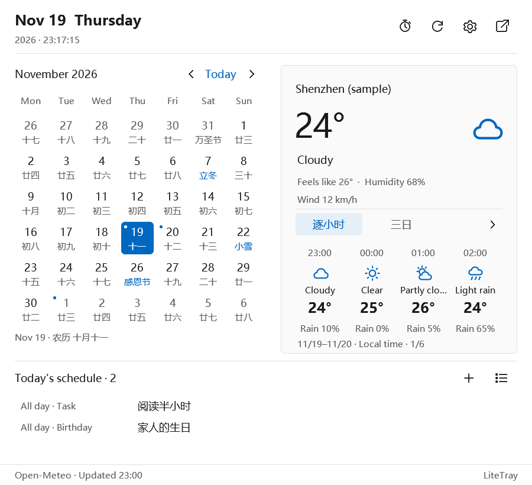
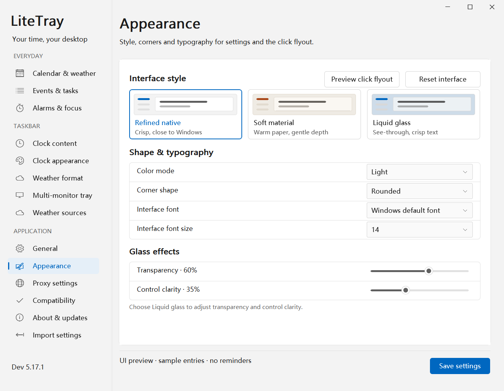
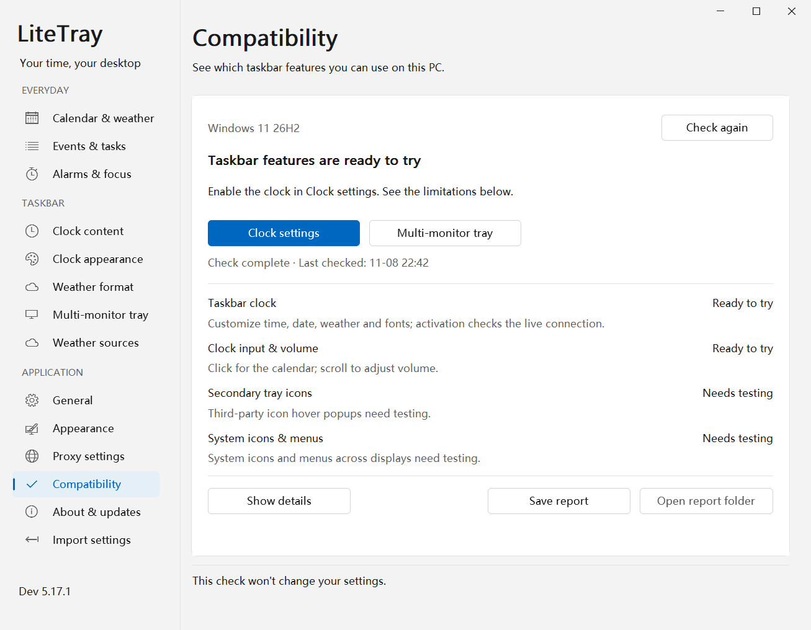

# LiteTray

> [!WARNING]
> **Development build with serious compatibility problems, being worked on.** The taskbar clock and tray mirroring load an adapter into the File Explorer process and call undocumented Shell interfaces. When the adapter fails, File Explorer crashes and restarts, and the taskbar and desktop disappear for a moment. Another program's installer telling Explorer to refresh its icons can also trigger this. After you quit LiteTray, the adapter stays in Explorer until Explorer restarts. Do not use it on a computer that needs to stay stable. See [Current limitations](#current-limitations).

[简体中文](README.md) · **English**

A useful clock, tray and calendar on every monitor. A native Windows desktop app built with Rust, with customizable taskbar clocks, mirrored tray icons, weather and local schedules.

<picture>
  <source media="(prefers-color-scheme: dark)" srcset="docs/images/calendar-5.17.1-en-dark.png">
  
</picture>

The taskbar is a live secondary-monitor capture of 5.12.0 (2026-11-08) using the user's Chinese clock template. The calendar is rendered by the native controls of 5.17.1 with sample weather and schedule data; lunar text and sample entry titles retain their original language. Images follow the page's light or dark theme.

## Download

[**Download the Windows x64 installer**](https://github.com/Lianzy-Baimiao/LiteTray/releases/latest) · [Changelog](CHANGELOG.md)

Download `LiteTray-<version>-Setup-x64.exe` from Releases, or the portable `LiteTray-<version>-windows-x64.zip`. The installer works per user and needs no administrator privileges. Settings, schedules and weather cache live in `%LOCALAPPDATA%\LiteTray`; upgrades and uninstall preserve user data. The installer is not digitally signed.

## Compatibility

Windows 11 x64 only; ARM64 is not implemented. The taskbar clock and tray mirroring are enabled only where the taskbar modules have been checked. Nine module sets are built in:

| Windows 11 | Build | Scenarios actually tested | Record (Chinese) |
| --- | --- | --- | --- |
| 21H2 | 22000.318 | Primary clock only: text, width, restoration. Both lines share the first line's style; secondary clocks and tray mirroring are unavailable | [21H2](docs/compatibility-21h2.md) |
| 22H2 / 23H2 | 22621.1702 / 22631.2861 | Primary-clock text and width updates, restoration, tray preparation and stop | [22H2 / 23H2](docs/compatibility-22h2-23h2.md) |
| 24H2 | 26100.1742 (Pro and Enterprise LTSC 2024) | Primary clock, tray preparation and stop; on Pro, also automatic recovery after a resolution change | [8037 / LTSC](docs/compatibility-next-versions.md) · [additional checks](docs/compatibility-completion-5.15.1.md) |
| 25H2 | 26200.8037 | Primary clock, tray preparation and stop; automatic recovery after a resolution change, a virtual `2 → 1 → 2` display cycle, and switching the second display between 100% and 125% scaling; primary-clock calendar clicks | [additional checks](docs/compatibility-completion-5.15.1.md) · [5.16.1](docs/compatibility-release-5.16.1.md) |
| 25H2 | 26200.8457 | Single display: primary-clock text and width updates, restoration, tray preparation and stop | [8457](docs/compatibility-8457.md) |
| 26H1 | 28000.1 | Single display: clock text updates, width changes and restoration, tray preparation and stop, primary-clock calendar clicks | [26H1](docs/compatibility-26h1.md) |
| 26H2 | 26300.9711 / 26300.9818 | 9818: single-display primary-clock text and width updates, restoration, tray preparation and stop; on a physical dual-monitor system with notifications present, clicks on both clocks, the notification bell, notification content and dismissal. 9711 has historical records only | [9818](docs/compatibility-9818.md) |

The single-display 9818 checks ran in Windows Sandbox and the dual-monitor checks on a physical system; everything else ran in independently installed virtual machines. The table lists the scenarios that were tested; it does not cover every cumulative update of a release. Real input, menus, tray mirroring, multiple monitors and mixed DPI are tracked by scenario and the full matrix is not complete. Physical monitor hotplug has not been accepted either. Build `28000.3365` of 26H1 remains experimental.

Host, XAML source and tray implementations are recognized separately, and a module that differs only in defined metadata can reuse an existing adaptation. A compatible clock that is enabled keeps working while an unrecognized tray is deferred; see the [recognition rules, Chinese](docs/module-recognition.md). For recovery after display changes, see the [recovery fix, Chinese](docs/hotplug-recovery-5.15.0.md). The result for your own computer is under **Settings → Compatibility**.

## Features

- **Taskbar clocks:** templates, individual weather fields, fonts, colors, alignment and presets. Width follows content; compact taskbars can use one or two lines.
- **Multiple monitors:** mirror the primary tray's icon order and visibility to secondary displays. Clock replacement and icon mirroring have separate switches.
- **Calendar and weather:** lunar dates, solar terms, popular festivals, Chinese public holidays and adjusted workdays; hourly forecasts, city search and approximate local location, with keyless weather providers. Detach and drag the calendar to keep it open.
- **Local schedules:** tasks, events, birthdays, anniversaries and countdowns, including editing directly in the calendar flyout.
- **Alarms and focus:** alarms, Pomodoro sessions, timers and optional sounds. Optional wheel volume control and middle-click mute over the taskbar clock.
- **Appearance:** three styles for the settings window and the calendar flyout (Refined native, Soft material, Liquid glass), rounded or square corners, interface font and size. Follows the Windows light/dark theme, accent color and high contrast.
- **Proxy:** weather, city search, holiday updates and update checks can follow the system proxy, connect directly, or use a manual HTTP / HTTPS / SOCKS5 proxy, with a connection test.
- **UI languages:** Simplified Chinese and English, following the Windows display language by default, with a manual choice in General. Lunar dates, almanac text and upstream holiday notices retain their original language.

<picture>
  <source media="(prefers-color-scheme: dark)" srcset="docs/images/appearance-5.17.1-en-dark.png">
  
</picture>

The Appearance page in 5.17.1, rendered offscreen by the native controls in the default Refined native style.

## Getting started

Choose to launch LiteTray when installation finishes to open settings. The home page's Taskbar clock card lets you enable the custom clock or restore the system clock directly. Use Clock settings to customize it, and Multiple monitors to choose your displays. Click the taskbar clock to open the calendar. An attached panel closes when you click outside it; a detached panel stays open. Closing settings keeps LiteTray running; use the tray menu to exit.

Open **Settings → Appearance** to change the style of the settings window and the calendar flyout. Changes preview immediately and are kept once you save.

Open **Settings → Compatibility** to see this computer's check results and feature limitations, with shortcuts to clock and multi-monitor settings. Module information and earlier test records are under Diagnostic details. You can save a report and open its folder. Passing the initial check means a feature is ready to try; LiteTray checks the actual connection when you enable it.

<picture>
  <source media="(prefers-color-scheme: dark)" srcset="docs/images/compatibility-5.17.1-en-dark.png">
  
</picture>

[Usage and development guide, Chinese](docs/usage.md) · [Installer guide, Chinese](docs/installer.md) · [Weather templates, Chinese](docs/weather-format.md) · [Proxy settings, Chinese](docs/proxy-settings-5.16.4.md)

[Compatibility checks and offline reports, Chinese](docs/compatibility.md) · [Windows 11 compatibility plan, Chinese](docs/windows11-compatibility-plan.md)

Choose **General → Language**, then save. Templates, entry titles and notes keep their original text. GitHub does not select a README based on your device language; use the language links at the top. [Language support](docs/languages.md)

## Current limitations

Taskbar integration uses an adapter inside Explorer and some undocumented Shell interfaces. Windows updates can affect compatibility, and adapter faults can affect Explorer. QQ popup placement is a separate experimental option, disabled by default.

The earlier report of a crash when clicking with Windows notifications present did not recur in 5.17.0 retesting on a dual-monitor 26300.9818 system (clock on both taskbars, notification bell, notification content and dismissal; toast banners were not covered).

A larger interface font size needs a larger settings window. Size 20 needs about 1513×1170 logical pixels, and the content does not fit on a display with a smaller work area.

See the [integration notes, Chinese](docs/taskbar-integration-and-store.md) and [Releases](https://github.com/Lianzy-Baimiao/LiteTray/releases) for other known limitations and validation details.

## Development and support

Requires Rust stable and Windows C++ build tools. Build with `tools/Invoke-Cargo.ps1`; package the installer with `tools/Build-Setup.ps1`.

Licensed under the [Apache License 2.0](LICENSE). Third-party components retain their respective licenses.

[Report an issue](https://github.com/Lianzy-Baimiao/LiteTray/issues) · [Support on Afdian](https://ifdian.net/a/lianzy) · [License details](docs/licensing.md) · [Third-party notices](THIRD-PARTY-NOTICES.md)
