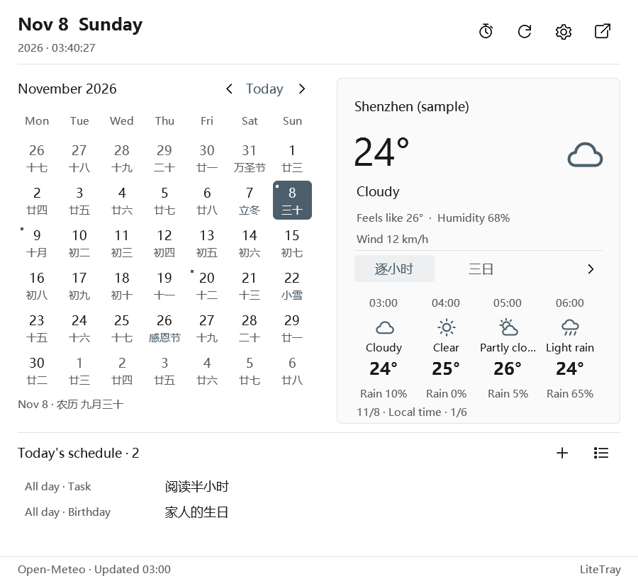
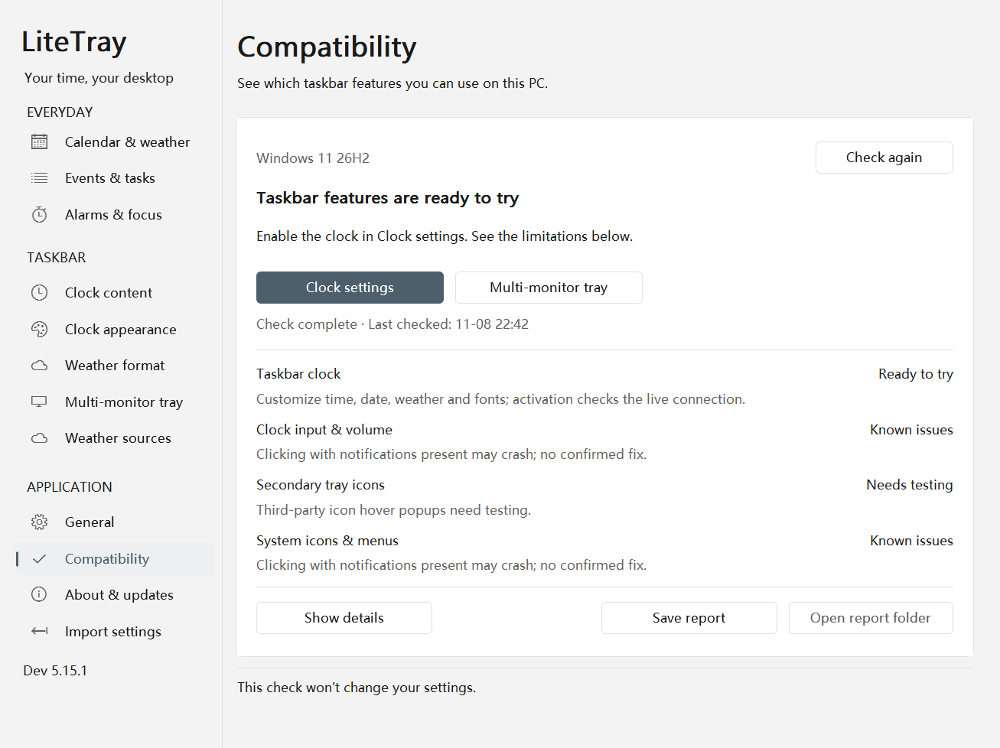

# LiteTray

> [!WARNING]
> **Development build with serious compatibility problems, being worked on.** The taskbar clock and tray mirroring load an adapter into the File Explorer process and call undocumented Shell interfaces. When the adapter fails, File Explorer crashes and restarts, and the taskbar and desktop disappear for a moment. Another program's installer telling Explorer to refresh its icons can also trigger this. After you quit LiteTray, the adapter stays in Explorer until Explorer restarts. Do not use it on a computer that needs to stay stable. See [Current limitations](#current-limitations).

[简体中文](README.md) · **English**

A useful clock, tray and calendar on every monitor. A native Windows desktop app built with Rust, with customizable taskbar clocks, mirrored tray icons, weather and local schedules.

<picture>
  <source media="(prefers-color-scheme: dark)" srcset="docs/images/calendar-5.12.0-en-dark.png">
  
</picture>

5.12.0 previews, refreshed on 2026-11-08. The taskbar is a live secondary-monitor capture using the user's Chinese clock template. The calendar uses the current native controls with sample weather and schedule data; lunar text and sample entry titles retain their original language. Images follow the page's light or dark theme.

## Download

[**Download the Windows x64 installer**](https://github.com/Lianzy-Baimiao/LiteTray/releases/latest) · [Changelog](CHANGELOG.md)

Download `LiteTray-<version>-Setup-x64.exe` from Releases. Installation is per user and needs no administrator privileges. Settings, schedules and weather cache live in `%LOCALAPPDATA%\LiteTray`; upgrades and uninstall preserve user data.

**Compatibility:** Since 5.14.2, the default build includes **seven exact x64 module sets from Windows 11 22H2 22621.1702, 23H2 22631.2861, Enterprise LTSC 2024 Evaluation 26100.1742, 25H2 26200.8037 / 26200.8457, and 26300.9711 / 26300.9818** in the default build. Since 5.15.0, host, XAML source and tray implementations are recognized independently, with strict equivalence for defined metadata-only changes. A requested, compatible clock can run while an unrecognized tray is deferred; see [recognition rules](docs/module-recognition.md). The added 22H2 and 23H2 systems have each passed primary-clock text/width updates, restoration and tray preparation/stop checks in independently installed VMs; see the [22H2 / 23H2 record](docs/compatibility-22h2-23h2.md) for tested binaries and scope. Earlier evidence remains in the [9818](docs/compatibility-9818.md), [25H2 8457](docs/compatibility-8457.md), and [8037 / LTSC](docs/compatibility-next-versions.md) records; 9711 retains historical evidence. These exact profiles do not cover every cumulative update. Actual input, menus, tray replication, multiple monitors and mixed DPI still need separate acceptance. LiteTray is still in development and the installer is not digitally signed.

5.15.0 also fixes a restoration path that could leave old taskbar sessions blocked after display changes and repeatedly reject clock commands. See the [recovery fix](docs/hotplug-recovery-5.15.0.md) for the cause, isolated regressions and upgrade guidance, and the [5.15.0 verification record](docs/compatibility-traits-5.15.0.md) for the exact package, guest results and retained failures. These checks do not constitute physical multi-monitor hotplug acceptance.

5.15.2 adds published-package verification records for ordinary **Pro 24H2 26100.1742** and **Pro 25H2 26200.8037**. Both independently installed VMs passed primary-clock and tray preparation/Stop checks, plus automatic recovery after actual resolution changes. Ordinary Pro 24H2 has the same taskbar module bytes as LTSC and reuses the existing implementation. See the [additional verification record](docs/compatibility-completion-5.15.1.md) for tested packages and precise scope.

## Features

- **Taskbar clocks:** templates, individual weather fields, fonts, colors, alignment and presets. Width follows content; compact taskbars can use one or two lines.
- **Multiple monitors:** mirror the primary tray's icon order and visibility to secondary displays. Clock replacement and icon mirroring have separate switches.
- **Calendar and weather:** lunar dates, solar terms, popular festivals, Chinese public holidays and adjusted workdays; hourly forecasts, city search and approximate local location, with keyless weather providers.
- **Local schedules:** tasks, events, birthdays, anniversaries and countdowns, including editing directly in the calendar flyout.
- **Alarms and focus:** alarms, Pomodoro sessions, timers and optional sounds. Optional wheel volume control and middle-click mute over the taskbar clock.
- **Windows appearance:** system light/dark theme, accent colors and high contrast; detach and drag the calendar to keep it open.
- **UI languages:** Simplified Chinese and English, following the Windows display language by default, with a manual choice in General. Lunar dates, almanac text and upstream holiday notices retain their original language.

## Getting started

Choose to launch LiteTray when installation finishes to open settings. The home page's Taskbar clock card lets you enable the custom clock or restore the system clock directly. Use Clock settings to customize it, and Multiple monitors to choose your displays. Click the taskbar clock to open the calendar. An attached panel closes when you click outside it; a detached panel stays open. Closing settings keeps LiteTray running; use the tray menu to exit.

Open **Settings → Compatibility** to see this computer's check results and feature limitations, with shortcuts to clock and multi-monitor settings. In 5.15.1, these fit on the first screen; module information and earlier test records are under Diagnostic details. You can save a report and open its folder. Passing the initial check means a feature is ready to try; LiteTray checks the actual connection when you enable it.

[Usage and development guide, Chinese](docs/usage.md) · [Installer guide, Chinese](docs/installer.md) · [Weather templates, Chinese](docs/weather-format.md)

[Compatibility checks and offline reports, Chinese](docs/compatibility.md) · [Windows 11 compatibility plan, Chinese](docs/windows11-compatibility-plan.md)

Choose **General → Language**, then save. Templates, entry titles and notes keep their original text. GitHub does not select a README based on your device language; use the language links at the top. [Language support](docs/languages.md)

## Current limitations

Taskbar integration uses an adapter inside Explorer and some undocumented Shell interfaces. Windows updates can affect compatibility, and adapter faults can affect Explorer. QQ popup placement is a separate experimental option, disabled by default.

A reported crash when clicking with Windows notifications present is still awaiting reproduction and a fix. See the [integration notes, Chinese](docs/taskbar-integration-and-store.md) and [Releases](https://github.com/Lianzy-Baimiao/LiteTray/releases) for known limitations and validation details.

## Development and support

Requires Rust stable and Windows C++ build tools. Build with `tools/Invoke-Cargo.ps1`; package the installer with `tools/Build-Setup.ps1`.

Licensed under the [Apache License 2.0](LICENSE). Third-party components retain their respective licenses.

[Report an issue](https://github.com/Lianzy-Baimiao/LiteTray/issues) · [Support on Afdian](https://ifdian.net/a/lianzy) · [License details](docs/licensing.md) · [Third-party notices](THIRD-PARTY-NOTICES.md)
