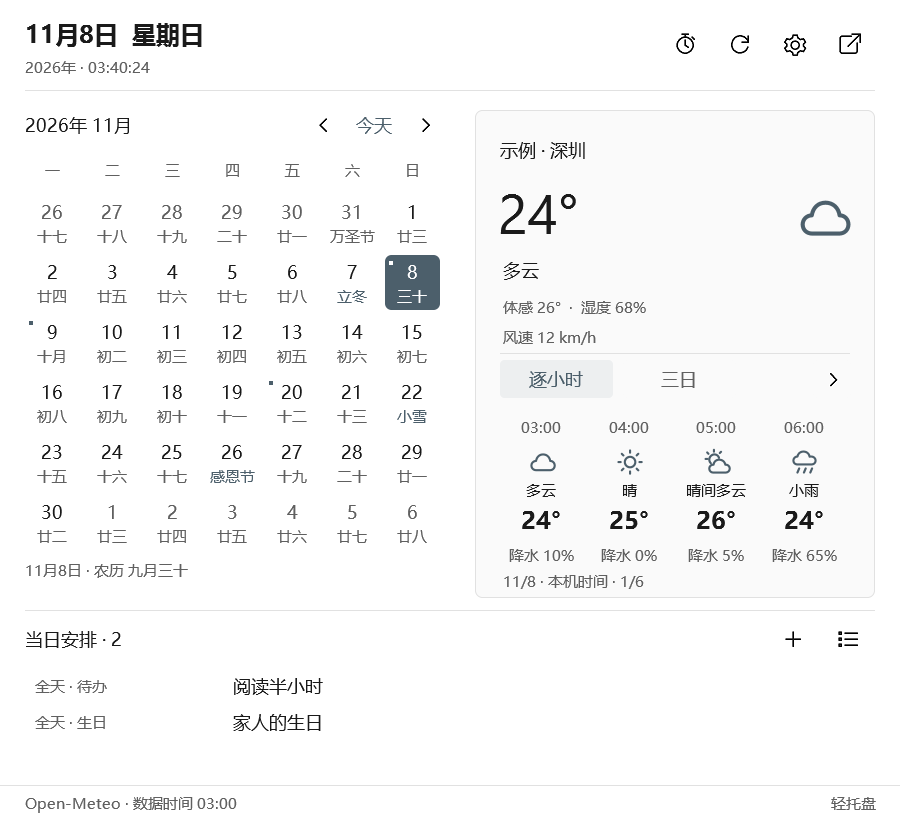

# LiteTray · 轻托盘

> [!WARNING]
> **开发版：存在严重的兼容性问题，正在处理。** 任务栏时钟和托盘复制会把适配器加载进资源管理器（Explorer）进程，并调用未公开的 Shell 接口。适配器出错时资源管理器会崩溃重启，任务栏和桌面会短暂消失；其他软件安装时通知资源管理器刷新图标，也可能触发。退出 LiteTray 后适配器仍留在资源管理器里，直到资源管理器重启。请不要在需要稳定运行的电脑上使用，详见[当前限制](#当前限制)。

**简体中文** · [English](README.en.md)

让每块屏幕都有顺手的时钟、托盘与日历。Rust 原生 Windows 桌面工具，提供任务栏时钟定制、多屏托盘复制、天气和本地日程管理。

<picture>
  <source media="(prefers-color-scheme: dark)" srcset="docs/images/calendar-5.12.0-zh-dark.png">
  
</picture>

5.12.0 预览，更新于 2026-11-08：任务栏为副屏实拍；日历由当前版本原生控件渲染，天气与日程使用示例数据。配图跟随页面明暗主题。

## 下载安装

[**下载 Windows x64 安装包**](https://github.com/Lianzy-Baimiao/LiteTray/releases/latest) · [更新记录](CHANGELOG.md)

在 Releases 下载 `LiteTray-<版本>-Setup-x64.exe`。按当前用户安装，无需管理员权限；配置、日程和天气缓存保存在 `%LOCALAPPDATA%\LiteTray`，升级和卸载均保留用户数据。

**兼容范围：**5.14.0 内置 **Windows 11 26300.9711 与 26300.9818 对应的 x64 系统模块**资料，按实际模块身份匹配；其他模块会拒绝相关接管。9818 已通过沙盒主屏时钟接管、停止恢复和托盘接口准备检查，副屏复制及真实菜单交互仍需分别验收，见 [9818 验证记录](docs/compatibility-9818.md)。当前仍为开发版，安装包尚未数字签名。

## 功能

- **任务栏时钟**：内容模板、天气属性、字体、颜色、对齐与预设；宽度随内容变化，小型任务栏可选单行或双行。
- **多屏托盘**：副屏复制主屏图标、顺序和显隐状态，时钟与托盘复制可独立设置。
- **日历与天气**：农历、二十四节气、常见节日、国务院放假与调休标记；小时预报、城市搜索和近似本地定位，支持免 Key 来源。
- **本地日程**：待办、日程、生日、纪念日、倒数日；可直接在日历弹层中维护事项。
- **闹钟与专注**：闹钟、番茄钟、定时提醒和可选铃声；时钟滚轮调音量、中键静音均可开关。
- **Windows 外观**：跟随明暗主题、强调色和高对比度；日历可分离、拖动并保持展开。
- **界面语言**：简体中文与 English，默认跟随 Windows 显示语言，也可在常规设置中切换。农历、黄历与上游公告保留原文。

## 使用

安装后打开设置，在“多屏托盘”选择屏幕，在“时钟显示”启用任务栏时钟。点击时钟打开日历，普通面板点击外部收起，分离后保持展开。关闭设置窗口后继续后台运行，从托盘菜单退出。

在 **设置 → 兼容性** 查看本机模块匹配、已收录资料和明确标注范围的验收记录。检测在后台只读执行，可导出当前报告；“模块匹配”仍需运行时核验，不代表所有点击、菜单或多屏场景已经通过。

[使用与开发说明](docs/usage.md) · [安装包说明](docs/installer.md) · [天气模板](docs/weather-format.md)

[兼容检查与离线报告](docs/compatibility.md) · [Windows 11 跨版本适配计划](docs/windows11-compatibility-plan.md)

软件语言在“常规设置 → 界面语言”中选择，保存后应用；模板、日程标题和备注不作翻译。GitHub README 提供顶部中英文链接，GitHub 本身不按本机语言自动切换 README。[语言支持说明](docs/languages.md)

## 当前限制

任务栏接管通过 Explorer 进程内适配器和部分未公开的 Shell 接口实现，系统更新可能影响兼容性；适配器故障也可能影响 Explorer。QQ 弹窗定位为独立实验选项，默认关闭。

存在 Windows 通知时点击可能崩溃的反馈仍待复现与修复。其他已知限制和验证情况见 [任务栏接入说明](docs/taskbar-integration-and-store.md) 与 [Releases](https://github.com/Lianzy-Baimiao/LiteTray/releases)。

## 开发与支持

需要 Rust stable 和 Windows C++ 工具链。构建入口：`tools/Invoke-Cargo.ps1`；安装包入口：`tools/Build-Setup.ps1`。

采用 [Apache License 2.0](LICENSE) 开源，第三方组件保留各自许可。

[提交问题](https://github.com/Lianzy-Baimiao/LiteTray/issues) · [爱发电支持作者](https://ifdian.net/a/lianzy) · [许可说明](docs/licensing.md) · [第三方声明](THIRD-PARTY-NOTICES.md)
