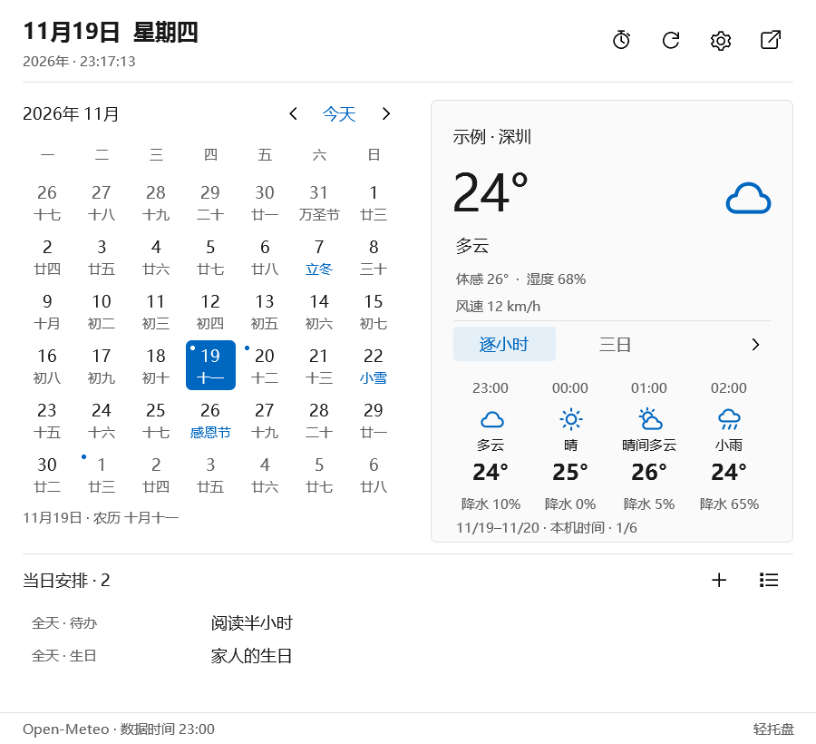
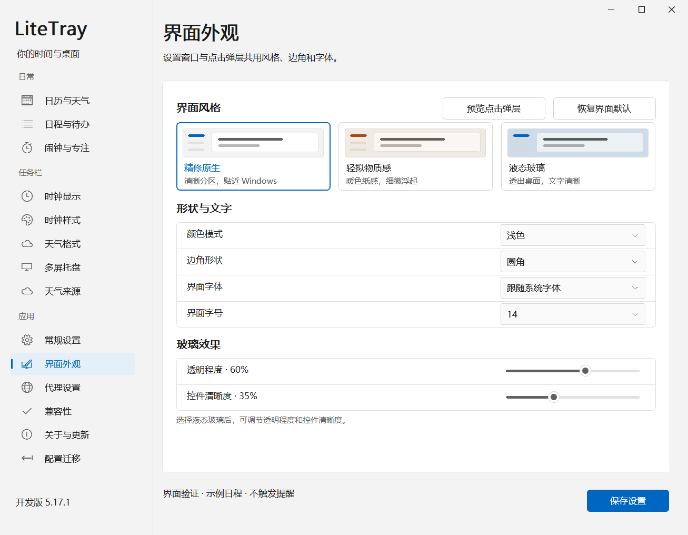
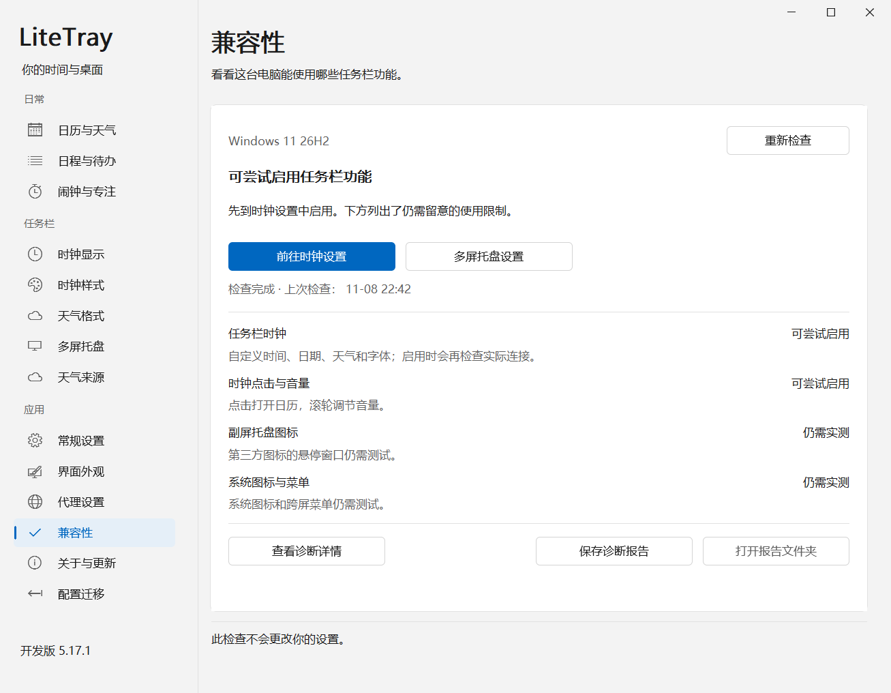

# LiteTray · 轻托盘

> [!WARNING]
> **开发版：存在严重的兼容性问题，正在处理。** 任务栏时钟和托盘复制会把适配器加载进资源管理器（Explorer）进程，并调用未公开的 Shell 接口。适配器出错时资源管理器会崩溃重启，任务栏和桌面会短暂消失；其他软件安装时通知资源管理器刷新图标，也可能触发。退出 LiteTray 后适配器仍留在资源管理器里，直到资源管理器重启。请不要在需要稳定运行的电脑上使用，详见[当前限制](#当前限制)。

**简体中文** · [English](README.en.md)

让每块屏幕都有顺手的时钟、托盘与日历。Rust 原生 Windows 桌面工具，提供任务栏时钟定制、多屏托盘复制、天气和本地日程管理。

<picture>
  <source media="(prefers-color-scheme: dark)" srcset="docs/images/calendar-5.17.1-zh-dark.png">
  
</picture>

任务栏为 5.12.0 的副屏实拍（2026-11-08）；日历由 5.17.1 的原生控件渲染，天气与日程使用示例数据。配图跟随页面明暗主题。

## 下载安装

[**下载 Windows x64 安装包**](https://github.com/Lianzy-Baimiao/LiteTray/releases/latest) · [更新记录](CHANGELOG.md)

在 Releases 下载 `LiteTray-<版本>-Setup-x64.exe`，或下载免安装的 `LiteTray-<版本>-windows-x64.zip`。安装版按当前用户安装，无需管理员权限；配置、日程和天气缓存保存在 `%LOCALAPPDATA%\LiteTray`，升级和卸载均保留用户数据。安装包尚未数字签名。

## 兼容范围

仅支持 Windows 11 x64，ARM64 尚未实现。任务栏时钟和托盘复制只在已核对过任务栏模块的系统上启用，内置九组模块资料：

| Windows 11 | 构建 | 实测过的场景 | 记录 |
| --- | --- | --- | --- |
| 21H2 | 22000.318 | 仅主屏时钟：文字、宽度、停止恢复。两行共用第一行样式；副屏时钟和托盘复制不支持 | [21H2](docs/compatibility-21h2.md) |
| 22H2 / 23H2 | 22621.1702 / 22631.2861 | 主屏时钟文字与宽度更新、停止恢复，托盘准备与停止 | [22H2 / 23H2](docs/compatibility-22h2-23h2.md) |
| 24H2 | 26100.1742（Pro 与 Enterprise LTSC 2024） | 主屏时钟、托盘准备与停止；Pro 上另测了分辨率变化后自动重新接管 | [8037 / LTSC](docs/compatibility-next-versions.md) · [补充验证](docs/compatibility-completion-5.15.1.md) |
| 25H2 | 26200.8037 | 主屏时钟、托盘准备与停止；分辨率变化、虚拟双屏 `2 → 1 → 2`、副屏 100% / 125% 缩放切换后自动恢复；主屏日历点击 | [补充验证](docs/compatibility-completion-5.15.1.md) · [5.16.1](docs/compatibility-release-5.16.1.md) |
| 25H2 | 26200.8457 | 单屏主屏时钟文字与宽度更新、停止恢复，托盘准备与停止 | [8457](docs/compatibility-8457.md) |
| 26H1 | 28000.1 | 单屏：时钟文字更新、宽度变化与恢复，托盘准备与停止，主屏日历点击 | [26H1](docs/compatibility-26h1.md) |
| 26H2 | 26300.9711 / 26300.9818 | 9818：单屏主屏时钟文字与宽度更新、停止恢复，托盘准备与停止；双屏实机上有系统通知时点击主副屏时钟、通知铃铛、通知内容和清除。9711 只有历史记录 | [9818](docs/compatibility-9818.md) |

9818 的单屏检查在 Windows 沙盒中完成，双屏检查在实机上完成；其余均在独立安装的虚拟机中完成。表中列出的是做过实测的场景，不代表同一版本的所有累计更新都已验证；真实点击、菜单、托盘复制、多屏和混合 DPI 按场景分别记录，完整矩阵尚未完成，物理显示器插拔也未验收。26H1 的 `28000.3365` 仍是实验状态。

程序按宿主、XAML 容器和托盘实现分别识别，只有元数据变化的等价模块可以复用已有适配；托盘未识别时，已启用且兼容的时钟继续工作，见[识别规则](docs/module-recognition.md)。显示器变化后的恢复见[恢复修复记录](docs/hotplug-recovery-5.15.0.md)。这台电脑的实际结果在 **设置 → 兼容性** 里查看。

## 功能

- **任务栏时钟**：内容模板、天气属性、字体、颜色、对齐与预设；宽度随内容变化，小型任务栏可选单行或双行。
- **多屏托盘**：副屏复制主屏图标、顺序和显隐状态，时钟与托盘复制可独立设置。
- **日历与天气**：农历、二十四节气、常见节日、国务院放假与调休标记；小时预报、城市搜索和近似本地定位，支持免 Key 来源。日历可分离、拖动并保持展开。
- **本地日程**：待办、日程、生日、纪念日、倒数日；可直接在日历弹层中维护事项。
- **闹钟与专注**：闹钟、番茄钟、定时提醒和可选铃声；时钟滚轮调音量、中键静音均可开关。
- **界面外观**：设置窗口和日历弹层可选精修原生、轻拟物质感、液态玻璃三种风格，以及圆角或直角、界面字体与字号；跟随 Windows 明暗主题、强调色和高对比度。
- **联网代理**：天气、城市搜索、节假日更新和版本检查可跟随系统代理、直接连接，或使用手动填写的 HTTP / HTTPS / SOCKS5 代理，并可测试连接。
- **界面语言**：简体中文与 English，默认跟随 Windows 显示语言，也可在常规设置中切换。农历、黄历与上游公告保留原文。

<picture>
  <source media="(prefers-color-scheme: dark)" srcset="docs/images/appearance-5.17.1-zh-dark.png">
  
</picture>

5.17.1 的“界面外观”页，由原生控件离屏渲染，图中为默认的精修原生风格。

## 使用

安装完成后选择启动程序，会打开设置首页。首页“任务栏时钟”卡片可直接启用托管，或随时恢复系统时钟；点击“时钟设置”调整内容和样式，需要选择屏幕时进入“多屏托盘”。点击任务栏时钟打开日历，普通面板点击外部收起，分离后保持展开。关闭设置窗口后继续后台运行，从托盘菜单退出。

在 **设置 → 界面外观** 更换设置窗口和日历弹层的风格，切换即时预览，保存后保留。

在 **设置 → 兼容性** 查看这台电脑的检查结果、各项功能的使用限制，并直接进入时钟或多屏托盘设置。模块与历史测试资料收在“诊断详情”里；报告保存后可打开所在文件夹。检查通过表示可以尝试启用，实际连接会在启用时再次确认。

<picture>
  <source media="(prefers-color-scheme: dark)" srcset="docs/images/compatibility-5.17.1-zh-dark.png">
  
</picture>

[使用与开发说明](docs/usage.md) · [安装包说明](docs/installer.md) · [天气模板](docs/weather-format.md) · [代理设置](docs/proxy-settings-5.16.4.md)

[兼容检查与离线报告](docs/compatibility.md) · [Windows 11 跨版本适配计划](docs/windows11-compatibility-plan.md)

软件语言在“常规设置 → 界面语言”中选择，保存后应用；模板、日程标题和备注不作翻译。GitHub README 提供顶部中英文链接，GitHub 本身不按本机语言自动切换 README。[语言支持说明](docs/languages.md)

## 当前限制

任务栏接管通过 Explorer 进程内适配器和部分未公开的 Shell 接口实现，系统更新可能影响兼容性；适配器故障也可能影响 Explorer。QQ 弹窗定位为独立实验选项，默认关闭。

此前“有 Windows 通知时点击可能崩溃”的反馈，在 5.17.0 的 26300.9818 双屏实机复测中未再出现（点击主副屏时钟、通知铃铛、通知内容和清除；通知横幅未覆盖）。

界面字号越大，设置窗口需要的最小尺寸越大；20 号约需 1513×1170 逻辑像素，显示器工作区更小时内容会排不下。

其他已知限制和验证情况见 [任务栏接入说明](docs/taskbar-integration-and-store.md) 与 [Releases](https://github.com/Lianzy-Baimiao/LiteTray/releases)。

## 开发与支持

需要 Rust stable 和 Windows C++ 工具链。构建入口：`tools/Invoke-Cargo.ps1`；安装包入口：`tools/Build-Setup.ps1`。

采用 [Apache License 2.0](LICENSE) 开源，第三方组件保留各自许可。

[提交问题](https://github.com/Lianzy-Baimiao/LiteTray/issues) · [爱发电支持作者](https://ifdian.net/a/lianzy) · [许可说明](docs/licensing.md) · [第三方声明](THIRD-PARTY-NOTICES.md)
