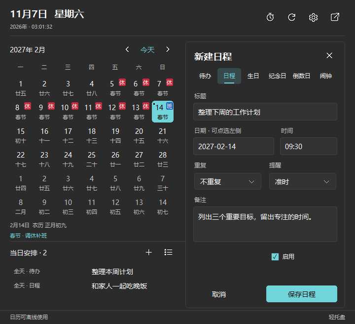
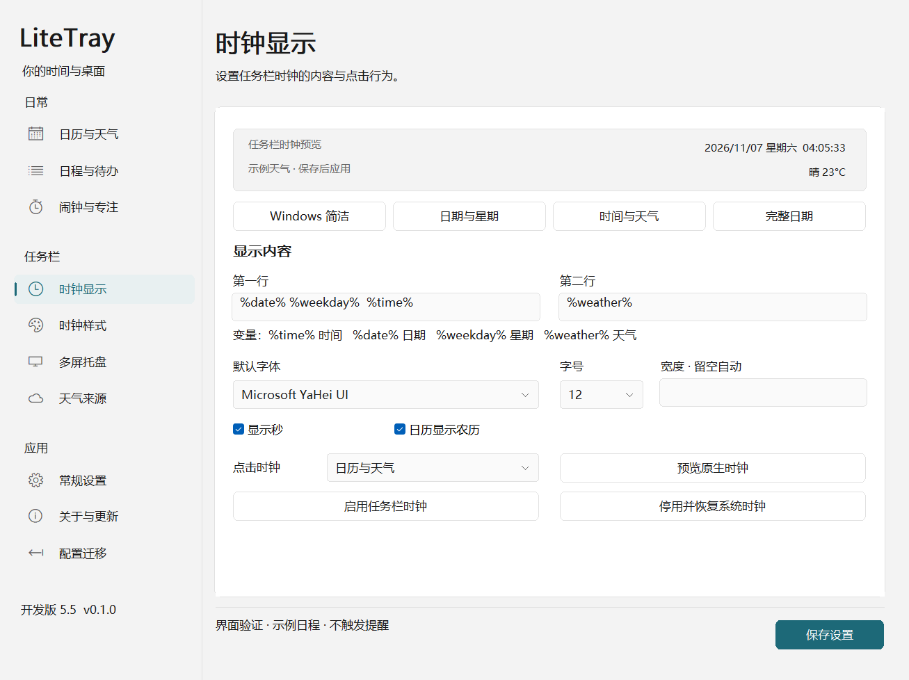
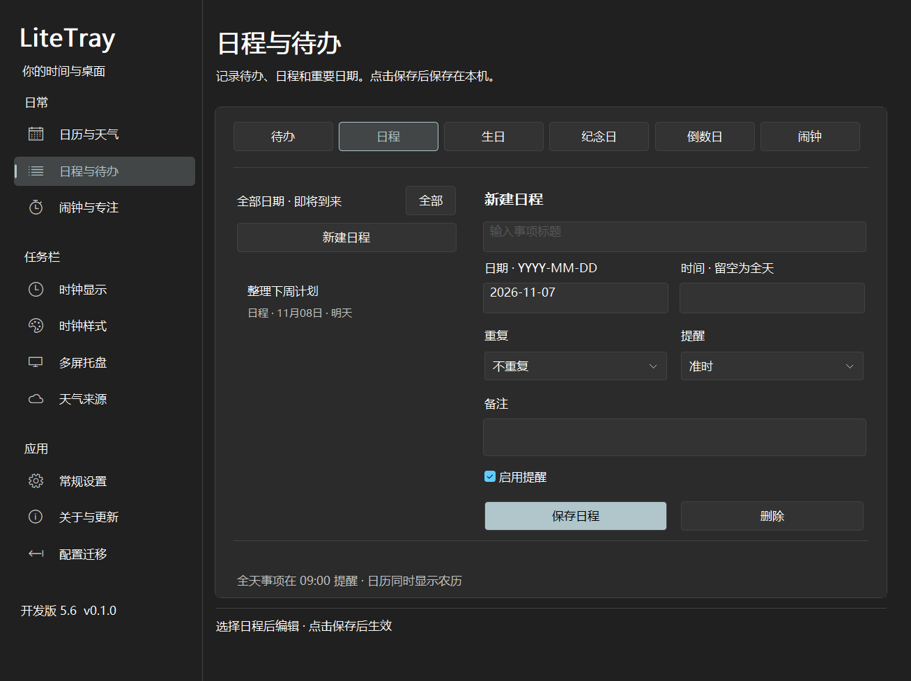

# LiteTray · 轻托盘

Rust 原生 Windows 任务栏工具，目标是替代 Windhawk 的 Taskbar Clock Customization 和 Taskbar multi-tray，提供可配置时钟、日历天气、日程与计时提醒。私有开发仓库，当前版本为 **开发版 5.4.2**。

## 当前能做什么

| 功能 | 当前状态 |
| --- | --- |
| 日历与天气同屏面板 | 月份切换、每日农历、国务院放假／调休补班标记、日程与当日安排、三日天气与缓存状态 |
| 日程与待办 | 六类直接切换的 Tab；重复、提前提醒、完成状态与本地保存；切换保留未保存输入 |
| 闹钟与专注 | 闹钟管理、番茄钟、定时提醒、记录与铃声短页；Windows 闹钟音/自定义 WAV、试听和停止 |
| Windows 外观 | 系统明暗、强调色、系统字体与高对比度配色；十页统一导航、控件与滚动内容区 |
| 时钟配置 | 四种预设、页面内预览、系统字体列表、字号列表与选色器；自动宽度、两行模板、各行对齐、悬停提示与 Windhawk 设置迁移 |
| 天气 | 五种来源、顺序切换、失败托底、城市绑定的离线缓存、Windows 凭据管理器 |
| 任务栏原位时钟 | **已在真实 Explorer 副屏验证写入、持续走时、停止恢复与进程意外退出恢复**；仅接受当前核对的系统模块 |
| 多屏托盘 | 应用图标、系统指示区、网络/音量及显示桌面区域已复制；主副屏实际顺序、尺寸与右侧位置对齐通过；悬停与菜单仍需应用级交互验收 |
| 关于与更新 | 无需密钥的 GitHub Releases / Tags 检查，语义版本排序与预览版过滤；私有开发仓库显示暂不可公开访问 |

**当前仍不能认定为两个 Windhawk 模块的完整替代品。** 独立时钟预览和离屏界面图都不证明任务栏替换成功。

## 开发版 5

5.4.2 补齐隐藏启动后第一次打开设置失败的情况：Windows 会将进程首次显示指令替换为启动器传入的隐藏／最小化状态。现在先检查实际窗口状态，必要时在同一次打开请求中恢复窗口，再激活并收起来源日历。回归测试使用全新进程和真实隐藏启动参数，不提前调用窗口隐藏来消耗首次显示行为。

5.4.1 已修复消息重入和最小化恢复路径：设置图标的命令不再依赖日历数据借用状态；主窗口忙于原生消息或对话框时保留打开请求，空闲后执行一次。最小化窗口会恢复，先显示并激活设置再收起普通日历，分离日历继续保持打开。显示窗口时不持有应用状态借用，避免恢复时的布局消息再次被丢弃。

5.4 将弹层的刷新、设置、分离、关闭、月份箭头和日程操作统一为 SVG 图标，提供悬停说明和键盘焦点。移除“放假表”按钮及常驻数据来源文字，放假用红底“休”、补班用蓝底“班”，高对比度模式仍使用系统配色。图标嵌入程序并直接绘制，不增加浏览器运行时。

点击日历下方的加号或已有事项，直接在弹层右侧新建、编辑与删除；左侧仍可选日期。六类事项支持标题、日期、时间、重复、提前提醒、备注及完成／启用状态。多于三条时使用列表旁的箭头翻页；只有主动点击“完整日程管理”图标才打开大窗口。弹层临时隐藏与主题变化保留编辑内容，保存失败保留输入，关闭编辑或“取消”放弃本次修改。退出程序不保存未提交草稿。



中国节假日与调休安排默认启用：日期角标“休”表示公告安排的放假日，“班”表示调休补班；日期下方显示节日名称，选中后查看完整说明与农历。不需要密钥或额外配置。

数据来自 MIT 开源项目 [NateScarlet/holiday-cn](https://github.com/NateScarlet/holiday-cn)，内置 2025–2027 年快照。启动及翻页时在后台按需更新，同一年有效缓存 24 小时；GitHub 原始地址失败后尝试 jsDelivr。缓存位于 `%LOCALAPPDATA%\LiteTray\holidays`，离线时保留有效数据；尚未公布或下载失败的年份显示无数据，不推测调休。日期标记描述公告安排，并不区分连休中的法定假日本体；普通周末可能未被上游列入。日程的“工作日”重复仍按周一至周五，暂不随调休改变。

5.2 修复系统日历与 LiteTray 同时打开的冲突：在专属时钟按钮内部的同尺寸布局区接收点击，在事件到达原生按钮前处理。空背景仅添加可恢复的透明填充，使上下留白也可点击；已处理事件不再重复投递。相邻通知铃铛仍独立。

设置页按日常、任务栏、应用分组。切换页面保留侧栏、页标题和底栏，在隐藏视口内创建内容后一次切换，内容子控件使用合成绘制。字体由已安装字体列表选择，字号由列表选择；多行编辑框按需显示滚动条。四种时钟预设同时设置内容、字号与对齐，宽度均自动，选择后保存生效。页面内预览使用示例天气，不会替换正式天气数据。



日历弹层现在置顶，打开时的任务栏焦点回跳不会立即将它关闭。右上角点击“分离”后，窗口保持展开，可拖动左上方日期/顶部空白区域，使用右上角“关闭”收起；再次点击任务栏时钟可打开独立的普通弹层。分离窗口在设置页切换、主题刷新时保持位置；跨屏拖动时按新屏 DPI 缩放，显示器断开后移回可见工作区。退出 LiteTray 会关闭全部窗口。

- 设置、日程、计时与日历使用统一的 Windows 配色。默认跟随系统，也可固定浅色或深色；系统主题变化后刷新配色，保留正在输入的文字。下拉框、列表、输入框、按钮与滚动条统一明暗。
- 固定导航、页标题和底部操作区，长内容在独立视口滚动，避免滚动表单遮住保存按钮。程序、标题栏、托盘使用内嵌的九尺寸图标。
- 日历天气面板为 720×656 逻辑像素，新增逐日农历、日程标记与当日安排，可直接打开所选日期的日程编辑或专注计时。农历闰月名称已校正。
- 本地日程和计时器共享同一数据模型；到期使用 Windows 通知和可选铃声，关闭设置窗口后继续运行。
- 日程类型改为顶部 Tab；专注、定时提醒、记录和铃声分别显示，最小窗口尺寸下无需外层滚动。
- 时钟点击不再同步复查 Explorer 忙碌状态；隐藏预建各屏日历并复用控件，点击不再重新创建整窗。短暂重入期间保留点击并延后处理。
- QQNT 原来的进程外事件修正只能在主屏显示后再移动。开发版 5 改用独立的小型线程钩子，在 QQ 处理完 `WM_WINDOWPOSCHANGING` 后、Windows 应用位置前定位；仅匹配 QQ 通知接收线程上的分层置顶悬停卡片，且鼠标必须位于受管理副屏的 QQ 图标内。宿主退出、停用或租期过期后不再修改位置；不重启 QQ。用户已确认 QQNT 指向弹层问题修复。
- 修复日期点击重建整组控件引起的闪烁：保留日期按钮和字体，只重绘发生变化的日期及当日安排，按钮使用缓冲绘制。
- 修复右键菜单祖先检查中的 COM 接口类型错误。隔离进程已复现旧实现的 `0xC0000409` 并验证修复；已加载旧适配 DLL 的 Explorer 需要结束后重新加载新版，单独重开 LiteTray 不会卸载旧 DLL。

以下是同一原生绘制代码生成的**离屏检查图，天气为示例**，不是桌面接管截图：


日程页的离屏检查图（列表为示例数据）：



## 日程、闹钟与计时

在大窗口的“日程与待办”直接选择类型 Tab，再点击“新建”；填写后点击对应类型的保存按钮。各类型暂未保存的输入在切换时保留。日历中点击加号会带入选定日期并打开弹层内编辑区，点击安排可直接修改对应条目。支持不重复、每天、工作日（周一至周五）、每周、每年，以及最多提前七天提醒。全天事项默认 09:00 提醒；生日和纪念日默认按公历每年重复，2 月 29 日在非闰年按 2 月 28 日处理。

“闹钟与专注”提供闹钟管理入口、番茄钟和多个定时提醒。番茄钟默认 25 分钟专注、5 分钟短休息，每四轮安排 15 分钟长休息；可自行调整。阶段结束后通知并准备下一阶段，等待手动开始。计时器支持暂停、继续和删除，重启后恢复进度。

“铃声”页可选 10 种 Windows 闹钟音、静音或本地 WAV 音乐，设置 5–120 秒响铃时长；试听 5 秒自动停止，也可在任一计时 Tab 点击“停止响铃”。使用 Windows 当前系统音量，不更改系统音量设置。

数据保存在 `%LOCALAPPDATA%\LiteTray\agenda.json`，无云同步。通知需要 LiteTray 后台运行，并遵循 Windows 通知设置。退出后不会唤醒电脑；下次启动补发到期计时器和最近 24 小时内未发送的日程提醒，最近 50 条通知留在本机。无法读取的日程文件会保留，并阻止覆盖。当前支持 **农历显示**，生日/纪念日的农历重复尚未实现。

## 使用与设置

默认打开设置，关闭设置窗口会收至托盘；从托盘菜单或常规设置退出程序。配置保存在 `%LOCALAPPDATA%\LiteTray`。开机启动默认关闭。

先在“多屏托盘”选择显示范围，再到“时钟显示”点击“启用任务栏时钟”。连接流程核对系统模块、任务栏窗口、屏幕、原生时钟元素与会话端点，收到 Active 后才显示运行中。“停用并恢复”需原生端确认 Closed，并保存停用状态。启用状态会保存，`--background` 在不显示设置窗口的情况下保持时钟与天气运行。“测试独立时钟预览”用于调样式，不影响真实任务栏。

时钟宽度留空时按两行实际内容自动扩展和收缩（配置中 `width: 0`）；需要固定宽度时可填 80–600。自动模式直接使用 XAML 的 Auto 布局，不按字符数估算。多屏页勾选“复制主屏托盘图标和隐藏图标入口”并保存，副屏使用主屏的原生数据模型、显隐及内容宽度；时钟和图标复制可以独立开启。源屏保留原位图标。已增加原生输入坐标修正、隐藏图标弹层定位和系统菜单的跨 XAML 根代理。QQNT 延迟悬停消息遗漏已补回并通过原生窗口回归检查；QQNT 实际悬停弹层、双击、右键、控制中心左键弹层和拖放仍需应用级交互验收。

实验原位路径当前只接受 Windows 11 build 26300.9711 x64 已核对的 taskbar.dll 与 twinui.pcshell.dll 哈希。其他系统版本拒绝套用私有偏移。Windows 10、系统升级、多屏热插拔、混合 DPI、自动隐藏与原系统点击行为仍需兼容验证。DLL 为保证回调生命周期，会固定加载到 Explorer 结束；停止成功后释放本次时钟属性、点击及私有宿主引用。

开发版标题包含“开发版 5.4.2”。从其他目录运行的旧 LiteTray 不会自动升级；新版检测到旧实例时会明确显示双方路径，避免静默打开旧界面。`LITETRAY_DATA_DIR` 可指定独立开发配置目录，凭据管理器仍按 Windows 用户共享。

## 天气来源

| 来源 | 认证 | 数据用途 |
| --- | --- | --- |
| Open-Meteo | 常规非商业免费接口无需 Key | 当前预估与三日预报 |
| MET Norway | 无需 Key，带可识别 User-Agent | 逐小时预报托底 |
| 和风天气 | API Host + API Key | 当前观测 |
| OpenWeather | API Key | 当前观测 |
| wttr.in | 无需 Key | 最后备用 |

支持调整顺序和刷新间隔。来源失败或过期后依次尝试，全部失败时使用有效缓存，并标记非实时。首次失败显示暂无数据；不会用示例值填充正式界面。天气服务 Key 存放于 Windows 凭据管理器，不写入配置 JSON。更新检查直接匿名读取公开 Releases 与 Tags，不读取凭据。各服务的发布用途和额度须遵守其条款。

## 构建与检查

需要 Rust stable 与 Windows C++ 链接工具。支持 MSVC，以及本机 GNU MinGW 开发工具链。

```powershell
.\tools\Invoke-Cargo.ps1 build --workspace --release --locked
.\tools\Invoke-Cargo.ps1 test --workspace --all-targets --locked
.\tools\Invoke-Cargo.ps1 -CargoArguments @('clippy','--workspace','--all-targets','--locked','--','-D','warnings')
.\tools\Test-XamlClock.ps1 -BinaryPath <release目录>\LiteTray.exe
.\tools\Test-ShellSource.ps1 -BinaryPath <release目录>\LiteTray.exe
.\tools\Render-Panel.ps1
.\tools\Render-UI.ps1
```

本机 GNU 产物在 `%USERPROFILE%\.cargo-target\litetray\release`。MSVC 可直接使用 `cargo`，默认产物在 `target\release`。`tools/Package.ps1` 将 EXE、同版本 DLL、说明及 SHA-256 清单放入指定目录。

`Test-XamlClock` 与 `Test-ShellSource` 只创建自身控件，不访问 Explorer。当前 124 项自动测试通过，包含设置首次打开与最小化恢复、100 次跨入口打开、弹层内六类日程持久化、错误输入、删除、翻页、草稿保留，以及日程通知去重、计时器重启、日历切换重绘、农历闰月、放假补班与离线缓存回归。设置激活测试在独立进程及非输入桌面上运行，不切换用户桌面。任务栏适配代码未在 5.3/5.4 改动，5.2 的 153 项原生 XAML 检查覆盖集合变化、替换/恢复、Auto 宽度、输入路由、菜单祖先接口和绑定恢复。界面渲染覆盖十个页面的浅深色、所有计时 Tab、最小窗口尺寸、外层滚轮隔离及日历／弹层编辑区的多 DPI 状态。`--self-test-app-icon` 检查可执行文件图标资源及不同 DPI 的加载尺寸。

2026-11-06 用户重新授权后，实际 GUI 启动与 Explorer 接入均成功。新增显式命令 `--test-secondary-clock <report.json>`：不打开窗口、不发送鼠标键盘输入，只向已核对的副屏原生时钟写入 6 次测试内容，检查系统刷新后仍保持，随后停止并检查恢复。没有副屏时拒绝修改。该命令确实会暂时更改副屏任务栏，不属于隔离自检；测试期间应关闭其他 LiteTray 原位连接。

`--test-secondary-tray <report.json>` 在同一后台流程中额外检查副屏生成的原生应用图标数量、独立复制模式和停止恢复；用长短天气文字检查原生宽度确实自动变化。此命令不模拟鼠标点击，不能代替菜单和回调位置验收。

实机后台实例持续显示秒和真实天气；主动结束该测试进程后，原生 watchdog 在 2 秒后的检查中已恢复系统时间。宿主工作集约 21.3 MiB、私有内存约 3.3 MiB，运行两分多钟累计 CPU 时间约 0.06 秒；这仅是一次宿主观察，不包括 Explorer 内的适配器，也不是与 Windhawk 的同口径对比。由于用户正在主屏游戏，后续测试没有发送输入；真实鼠标点击、跨屏菜单和 Explorer 重启仍不计为验收通过。

## 配置迁移与命令行

`tools/Export-WindhawkProfile.ps1` 只读导出两个模块的设置，原设置不变。设置中的“配置迁移”页先预览逐字段转换报告，采用草稿并保存后写入 LiteTray。无法转换的格式保留原行并报告原因。迁移不会自动停用 Windhawk 或启用任务栏连接。

常用参数：`--settings`、`--calendar`、`--background`、`--clock-preview`、`--diagnose [file]`、`--weather-check [file]`、`--check-updates`、`--preview-windhawk <profile.json> [new-report.json]`。原生开发检查与只读探测参数见 `--help`。

`--show-secondary [calendar|agenda|timers|clock|appearance]` 在副屏显示指定页面，不激活窗口，不改保存的配置。日常打开请使用 `--settings` 或托盘入口。

`cargo run --example tray_windows -- 60` 可记录 60 秒实际弹窗的进程、窗口类和几何，不读取窗口内容、不移动鼠标。重定向为 JSONL 后，用 `tools/Test-TrayPopupPlacement.ps1 -ReportPath <file>` 检查副屏悬停观测；没有真实悬停样本返回 INCONCLUSIVE，不能视为通过。

- [完整产品规格](docs/implementation-plan.md)
- [开发与验证记录](docs/progress.md)
- [任务栏 source 依据与限制](docs/taskbar-source-binding.md)
- [原生 ABI 说明](crates/taskbar-adapter/ABI.md)
- [第三方声明](THIRD-PARTY-NOTICES.md)
