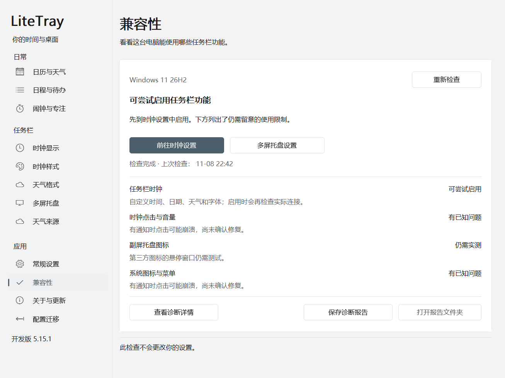

# 任务栏兼容检查

5.13.0 开始将系统兼容资料集中到内置档案。自 5.14.2 起默认包含 [Windows 11 26300.9711 x64](../crates/adapter-protocol/profiles/windows11-26300.9711-x64.json)、[26300.9818 x64](../crates/adapter-protocol/profiles/windows11-26300.9818-x64.json)、[25H2 26200.8457 x64](../crates/adapter-protocol/profiles/windows11-26200.8457-x64.json)、[25H2 26200.8037 x64](../crates/adapter-protocol/profiles/windows11-26200.8037-x64.json)、[Enterprise LTSC 2024 Evaluation 26100.1742 x64](../crates/adapter-protocol/profiles/windows11-26100.1742-x64.json)、[22H2 22621.1702 x64](../crates/adapter-protocol/profiles/windows11-22621.1702-x64.json) 和 [23H2 22631.2861 x64](../crates/adapter-protocol/profiles/windows11-22631.2861-x64.json) 七组精确模块资料；宿主 EXE、Explorer 适配器及私有宿主隔离测试共同使用同一套选择规则。

**5.15.0 改为按模块实现识别和功能协商，上述七组是参考实现与实测记录。** 当前模块先核验完整身份；只有明确元数据变化、完整代码/数据/布局保持相同时才允许实现等价匹配。任务栏宿主、XAML 容器、托盘模块各自识别并按已实现的接口组合，时钟与托盘分别判断。详见[识别规则与边界](module-recognition.md)。验收范围仍按功能和场景分别记录。 新增 22H2 和 23H2 在两台独立安装客体通过六项检查及独立复核后进入默认目录。六组新增资料分别取得主屏时钟文字/宽度更新、停止恢复和托盘入口准备/停止证据；9711 保留历史记录。日历点击、滚轮音量、实际托盘复制及菜单/悬停、多屏和混合 DPI 尚未完成验收。各组证据与所测二进制身份见 [22H2 / 23H2 记录](compatibility-22h2-23h2.md)、[9818 兼容记录](compatibility-9818.md)、[25H2 虚拟机记录](compatibility-8457.md)及 [8037 / LTSC 记录](compatibility-next-versions.md)。

**5.15.0 发布二进制的复测另列于[最终候选验证](compatibility-traits-5.15.0.md#最终候选-r3-的身份与验证)**，其中包含精确包身份、客体结果与失败记录。显示器变化后的恢复修复及四项隔离回归见[热插拔恢复记录](hotplug-recovery-5.15.0.md)。5.15.1 调整兼容性页面，不扩大虚拟机或物理多屏验收范围。下文的历史支持目录不能替代当前包的复测。

同一 5.14.2 默认程序已在 22H2 / 23H2 两台客体完成六项复测，包哈希、真实文字/宽度与完整原始恢复、加载模块、普通权限和 Explorer 连续性均经独立核对。22H2 默认首轮 Start 拒绝及跨分钟比较失败仍保留，后续同包在分钟中段通过；记录不会将这次通过等同于首轮拒绝根因已修复。

8037 与 LTSC 最初仅加入 `compatibility-lab`，分别在独立客体用冻结 lab 包完成模块/布局、单屏时钟更新与恢复、托盘准备/停止三项限定验收后，移入 5.14.1 默认目录。**同一份 5.14.1 默认二进制已在两个唤醒后的独立客体完成六项复测，显示保持与恢复也通过。** LTSC 还取得三次测试文字、原生恢复和稍后走时的实际截图；这些有限静帧不等于连续原生刷新或完整输入/多屏矩阵验收。LTSC 早先首次读取失败的具体原因仍未证实；另一次许可到期计划关机与默认启动前权限条件失败分别记录。8037 lab 外层超时及随后原进程完整完成的历史也保留。5.14.1 的默认与显式 lab 构建均包含五组，5.14.2 扩展至七组。精确哈希及各轮成功/失败记录见 [后续版本验证证据](compatibility-next-versions.md)。

## 兼容性页签

打开设置 → **兼容性**。首次进入会在后台检查本机，也可以点击“重新检查”。首屏给出结论、下一步和四项功能的状态，并提供“前往时钟设置”“多屏托盘设置”入口。匹配结果显示为“可尝试启用”，有通知点击问题或测试限制的功能分别说明；文件检查不会被标记为实际运行通过。



上图由原生窗口在非输入桌面渲染，使用固定示例结果，展示页面布局；不是当前机器的实测证据。[英文预览](images/compatibility-5.15.1-en-light.png)。

检测读取本机注册表中的版本信息和系统 DLL 文件，不加载适配器、不访问 Explorer 进程、不联网，也不修改用户设置。完成后更新当前页的结果；切到其他页面不会因检测完成重新打开兼容性页。检测失败时保留上次完成的快照及时间，并显示本次错误，旧结果不能被当成本次成功。

“查看诊断详情”中保留完整系统信息、模块匹配依据、哈希、失败原因、功能限制和历史测试记录。只有三个目标模块全部匹配时，页面才关联该资料的既有验收记录；部分模块匹配时仍按各功能显示结果。内置目录中的时钟验收状态仅描述记录中的时钟范围。系统版本标签用于辨识环境，不按 24H2、25H2 或某个构建号区间放行。

目录中的验收状态含义如下，均不代表当前 Explorer 会话已经通过检查：

| JSON 状态 | 页面含义 | 范围 |
| --- | --- | --- |
| `tested` | 已有实测（限定范围） | 记录注明的环境和场景有实测证据，例如 9818、8457、8037、LTSC 1742、22H2 1702 和 23H2 2861 的单屏主时钟更新、恢复及托盘准备/停止；应按记录核对所测包 |
| `historical` | 历史记录，当前包未复测 | 保留 9711 旧环境的时钟和托盘记录，不代表当前包重新完成旧系统回归 |
| `not_run` | 尚未验收 | 该场景的完整验收未完成，不能用模块匹配或其他场景通过代替 |

验收记录同时绑定模块身份和所用解析方案：时钟记录核对宿主/source 的布局与虚表，托盘相关记录还核对 ABI 和三个函数入口。新增模块、修改偏移或更换入口都不能自动继承旧方案的验收。七份资料复用经各自核验的 source 和拓扑方案；5.15.0 中 22H2/23H2/LTSC 的托盘矩形入口使用四参数借用对象 ABI，其他四组使用三参数按值 ABI。LTSC 原三参数入口实际服务 Copilot，本版选择经完整指令和调用用途核验的 DragDropManager 入口；兼容性页的内置历史目录仅保留适用的旧包时钟记录，旧入口的准备记录不属于新入口的验收。22H2、23H2、8457、8037、LTSC 的托盘代码载体为 `Taskbar.View.dll`，9711/9818 为 `SystemTray.dll`。宿主元素和 host→child 字段由各自已识别的实现提供；每组地址与映像仍独立核验。这些共性不能推导其他 Windows 构建自动兼容。

## 导出方式

兼容性页点击 **保存诊断报告**，把页面当前显示的快照保存为 `%LOCALAPPDATA%\LiteTray\reports\compatibility-*.json`。导出在后台完成，每次创建新文件；保留该次检测时间，不重新扫描。保存后点击“打开报告文件夹”即可找到文件。文件包含 `os` 环境信息、`compatibility` 磁盘报告和 `supported_profiles` 内置目录及验收范围。

设置 → 常规设置 → **导出诊断信息**，后台生成 `%LOCALAPPDATA%\LiteTray\diagnostics.json`，其中 `compatibility` 包含磁盘兼容检查。

也可以单独运行，不读取用户配置、不加载适配 DLL、不访问 Explorer 进程、不联网：

```powershell
.\LiteTray.exe --compatibility-report .\compatibility.json
```

报告文件必须尚不存在，避免覆盖其他文件。检查从其他 Windows 镜像提取的目录：

```powershell
.\LiteTray.exe --compatibility-report .\offline.json --system-root 'D:\Extracted\Windows'
```

此处的目录须保留 `System32`、`SystemApps` 等相对结构。不加载其中的 DLL，不要求该系统可启动。离线报告的 `os_build` 为 `null`，不会错误套用正在运行的系统版本。

## 读懂结果

报告分开列出 `clock_appearance`（时钟文字/样式）、`clock_input`（时钟交互）、`tray_mirroring`（应用托盘复制）和 `system_areas`（系统区域）。后两项额外依赖托盘坐标入口。

| 状态 | 含义 |
| --- | --- |
| `disk_matched_live_check_required` | 磁盘模块和内置布局匹配；接管前仍必须在所属线程核验已加载模块、窗口、对象及 XamlRoot |
| `unsupported_modules` | 模块可读取，但完整图像和实现等价识别均未通过，需要适配该模块的结构 |
| `missing_modules` | 必需模块不存在；请同时查看是否发现另一代任务栏模块 |
| `inspection_failed` | 文件无法读取、PE 数据损坏或布局验证失败 |

`all_profile_images_matched` **不是正在运行或完整兼容的证明**。`loaded_modules_checked`、`runtime_topology_checked` 在这份磁盘报告中始终为 `false`。系统更新可能令磁盘文件与 Explorer 已加载的映像不同，适配器仍独立验证内存身份和函数入口。

5.15.0 报告 schema 为 2。每项 `modules[].recognition` 记录 `exact_image` 或 `execution_equivalent`、参考实现与字段/ABI说明。`implementation` 记录当前模块组合、source/拓扑方案及托盘调用方式和用途。`profile_id` 仅在三个模块均完整匹配同一份历史资料时存在；等价图像或跨资料组合不会继承历史实测。`all_profile_images_matched=false` 并不必然表示不可用，应按 `features` 判断。未知托盘不会阻止已识别的时钟路径，但未知宿主/source仍拒绝接管。

`baseline_limitations` 记录参考版本仍存在的限制：通知点击崩溃反馈待复现、系统图标及跨屏菜单验证未全面完成、第三方悬停弹窗需单独验证。这些信息不会因磁盘匹配而被隐藏。

## 接管策略

- 每份档案内置六个宿主符号、两处对象字段、具体虚表及三个托盘坐标入口。9818、8457 的地址和入口字节来自各自匹配的微软 PDB 及映像重新解析；字段和 ABI 经过重新核验后复用现有解析方案。生产启动不再调用 DbgHelp、不下载 PDB，也不读取外部符号映射。
- 原来的 `--prepare-symbols` 保留为开发分析工具，其输出不能覆盖内置生产档案。
- 运行中的适配器继续检查实际加载路径、PE/PDB 身份、函数字节、线程、控件归属与停止恢复。未知布局仍拒绝接管。
- 5.15.0 实现磁盘能力协商：同时请求时钟和托盘，而只有托盘模块未识别时，启用时钟、暂缓托盘并显示原因，保存的用户偏好不变。仅请求托盘时不会擅自开启时钟。运行时模块/对象验证失败仍终止本次准备并按既有恢复流程处理，不能捕获任意错误后跳过检查。
- 内置 JSON 编译进入程序。修改安装目录中的资料文件不会改变接管行为；目前没有在线兼容包或任意外部偏移覆盖入口。

## 验证与后续

`tools/Test-Compatibility.ps1` 复制单独 EXE，在无适配 DLL、故意损坏的测试配置和离线文件树上检查导出、错误分类、禁止覆盖及不修改配置/符号缓存。它适合通用 CI，但不能代替真实任务栏检查。

当前证据范围：

| 模块资料 | 已有验证 | 尚不能据此宣称 |
| --- | --- | --- |
| 26300.9711 x64 | 保留原有内置资料；更新前已有主副屏 source、时钟、拓扑、几何与托盘模型顺序/宽度/对齐记录 | 本次 9818 候选包重新完成了 9711 的真实桌面回归，或旧有全部交互限制已经解决 |
| 26300.9818 x64 | 新资料精确匹配；Sandbox 基线四项命令均 exit 0、原生 XAML 164 项通过；应用进程内私有 Shell source 6 项通过；真实主屏时钟宽度 240→320，停止后恢复原文字、宽度和可见性；5 类必需托盘区域与坐标入口完成准备/停止，未启用托盘复制 | 日历点击、滚轮音量、托盘复制及菜单/悬停交互、多显示器和混合 DPI 已完成验收 |
| 26200.8457 x64 | 独立 Windows 11 Pro 25H2 虚拟机；基线四项命令均 exit 0、原生 XAML 164 项、私有 Shell source 6 项通过；真实主屏完成三帧文字更新和 55→240→320→55 宽度变化/恢复；5 类必需托盘区域与坐标入口完成准备/停止，未启用复制 | 其他 25H2 累计更新、真实日历/音量/菜单/悬停输入、托盘复制、多显示器和混合 DPI 已完成验收 |
| 26200.8037 x64 | 独立 Windows 11 Pro 25H2 虚拟机的 lab 与 5.14.1 默认包六项均通过；三帧文字/尺寸更新与恢复、5 类托盘区域准备/停止、实际 loaded 身份匹配通过；默认轮显示保持/恢复通过，父启动器正常观察到完成 | 逐帧屏幕绘制、持续原生刷新、完整输入、托盘复制、多屏/DPI 已验收 |
| 26100.1742 x64 | 独立 Windows 11 Enterprise LTSC 2024 Evaluation 虚拟机的 lab 与 5.14.1 默认包六项均通过；三帧更新/恢复、5 类托盘区域准备/停止、loaded 身份和显示保持/恢复通过；截图记录三次测试文字、原生恢复和稍后走时 | 普通 24H2 Home/Pro/Enterprise 自动兼容，或连续原生刷新、完整输入、托盘复制、多屏/DPI 已验收 |
| 22621.1702 x64 | 独立 Windows 11 Pro 22H2；六项检查及独立复核通过，三次时钟文字读回与 56→240→320→56 宽度恢复，时间/日期/容器原始对象完整恢复；三坐标入口和 5 类托盘区域准备/停止通过，复制未激活 | 其他 22H2 月更、像素绘制/刷新计数、完整输入、托盘复制、多屏/DPI 已验收 |
| 22631.2861 x64 | 独立 Windows 11 Pro 23H2；六项检查及独立复核通过，三次时钟文字读回与 56→240→320→56 宽度恢复，实际 loaded 模块和完整原始恢复一致；托盘准备/停止及显示保持/恢复通过 | 其他 23H2 月更、像素绘制/刷新计数、完整输入、托盘复制、多屏/DPI 已验收 |

9818 的真实任务栏测试期间，Explorer PID/TID 与主任务栏 HWND 保持不变，未以重启 Explorer 代替恢复。Sandbox 来宾标为 Enterprise 24H2 `26100.9818`，但本次三份关键模块与宿主 `26300.9818` 相同；该标签不构成独立 24H2 系统镜像覆盖。详细结果与证据路径见 [9818 兼容记录](compatibility-9818.md)。

跨版本设计和一手资料见 [实施方案](windows11-compatibility-plan.md) 与 [研究记录](windows11-compatibility-research.md)。下一里程碑仍是独立 Windows 11 分支的主副屏完整功能矩阵；本次新增模块组的主屏接管结果不满足这一完整退出条件。

25H2 使用独立安装的系统和 `Taskbar.View.dll` 变体，提供了另一分支的真实单屏证据。前两轮分别遇到窗口发现遗漏和响应未返回；修复发现路径后，相同冻结 lab 包在已核验的 Medium 完整性 helper 中通过，随后默认生产构建也以新的包与程序哈希完成六项检查。实验环境应核对登录会话、桌面及与 Explorer 一致的普通用户完整性，不能直接继承提升权限的首次登录 bootstrap。两种冻结包的清单、失败记录与恢复读回见 [25H2 虚拟机记录](compatibility-8457.md)。最终分发包补入验收文档时清单会变化，程序必须与已测默认二进制一致。

2026-11-08 更新前的 9711 / 5.13.0 基线记录：完整 workspace 测试 207 项、独立 EXE 导出检查 5 项、私有 Shell 宿主 6 项、原生 XAML 159 项通过。后台切换至 5.13.0 后，主副屏 source/时钟/拓扑/几何检查无错误，托盘图标模型顺序、宽度和对齐一致；用户配置及日程文件哈希保持不变。这是历史基线，不是本次 9818 候选包在 9711 上重跑的结果。
