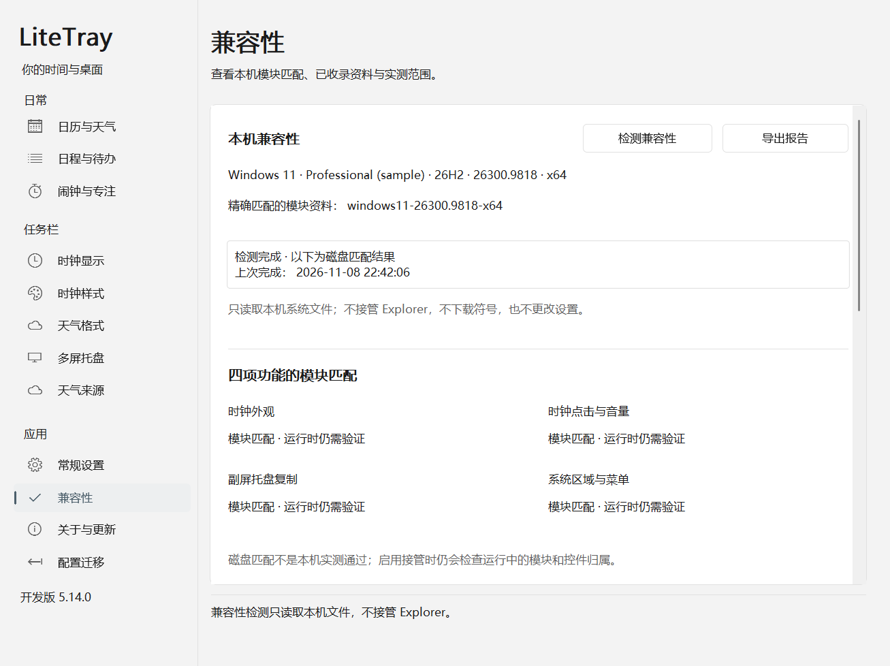

# 任务栏兼容检查

5.13.0 开始将系统兼容资料集中到内置档案。5.14.1 默认包含 [Windows 11 26300.9711 x64](../crates/adapter-protocol/profiles/windows11-26300.9711-x64.json)、[26300.9818 x64](../crates/adapter-protocol/profiles/windows11-26300.9818-x64.json)、[25H2 26200.8457 x64](../crates/adapter-protocol/profiles/windows11-26200.8457-x64.json)、[25H2 26200.8037 x64](../crates/adapter-protocol/profiles/windows11-26200.8037-x64.json) 和 [Enterprise LTSC 2024 Evaluation 26100.1742 x64](../crates/adapter-protocol/profiles/windows11-26100.1742-x64.json) 五组精确模块资料；宿主 EXE、Explorer 适配器及私有宿主隔离测试共同使用同一套选择规则。

**当前内置支持范围为上述五组已核验的 x64 模块，验收范围按功能和场景分别记录。** 9818 的单显示器 Sandbox、8457 的独立 25H2 虚拟机均已通过真实主屏时钟文字/宽度更新、停止恢复和托盘入口准备/停止检查；日历点击、滚轮音量、实际托盘复制及菜单/悬停、多屏和混合 DPI 尚未验收。9711 保留历史记录。各组证据与所测二进制身份见 [9818 兼容记录](compatibility-9818.md) 和 [25H2 虚拟机记录](compatibility-8457.md)。

8037 与 LTSC 最初仅加入 `compatibility-lab`，分别在独立客体用冻结 lab 包完成模块/布局、单屏时钟更新与恢复、托盘准备/停止三项限定验收后，移入 5.14.1 默认目录。**同一份 5.14.1 默认二进制现已在两个唤醒后的独立客体完成六项复测，显示保持与恢复也通过。** LTSC 还取得三次测试文字、原生恢复和稍后走时的实际截图；这些有限静帧不等于连续原生刷新或完整输入/多屏矩阵验收。LTSC 早先首次读取失败的具体原因仍未证实；另一次许可到期计划关机与默认启动前权限条件失败分别记录。8037 lab 外层超时及随后原进程完整完成的历史也保留。当前默认与显式 lab 构建均包含五组。精确哈希及各轮成功/失败记录见 [后续版本验证证据](compatibility-next-versions.md)。

## 5.14.0 兼容性页签

打开设置 → **兼容性**。首次进入会在后台检测本机，也可以点击“检测兼容性”重新读取。页面显示 Windows 版本标签、构建号与 UBR、系统架构、精确匹配的资料，以及时钟外观、时钟点击与音量、副屏托盘复制、系统区域与菜单四项功能的磁盘状态。系统标签用于辨识环境，模块匹配不按 24H2、25H2 或某个构建号区间放行。



上图由原生窗口在非输入桌面渲染，采用明确标注的示例系统信息；它展示页面布局，不作为当前机器的实测证据。[英文预览](images/compatibility-5.14.0-en-light.png)。

检测读取本机注册表中的版本信息和系统 DLL 文件，不加载适配器、不访问 Explorer 进程、不联网，也不修改用户设置。完成后更新当前页的结果；切到其他页面不会因检测完成重新打开兼容性页。检测失败时保留上次完成的快照及时间，并显示本次错误，旧结果不能被当成本次成功。

“已登记的实测范围”与本机磁盘结果分开展示。只有三个目标模块全部匹配时，页面才关联该资料的既有验收记录；部分模块匹配时仍按各功能显示结果。“已收录的模块资料”列出程序内置目录，其中的时钟验收状态仅描述记录中的时钟范围。展开检测详情可查看模块哈希、失败原因和各场景的具体边界。

目录中的验收状态含义如下，均不代表当前 Explorer 会话已经通过检查：

| JSON 状态 | 页面含义 | 范围 |
| --- | --- | --- |
| `tested` | 已有实测（限定范围） | 记录注明的环境和场景有实测证据，例如 9818、8457、8037 和 LTSC 1742 的单屏主时钟更新、恢复及托盘准备/停止；应按记录核对所测包 |
| `historical` | 历史记录，当前包未复测 | 保留 9711 旧环境的时钟和托盘记录，不代表当前包重新完成旧系统回归 |
| `not_run` | 尚未验收 | 该场景的完整验收未完成，不能用模块匹配或其他场景通过代替 |

验收记录绑定资料 ID 和三个模块的 SHA-256。新增资料或替换其中的映像，默认不会继承旧资料的验收状态。五份资料共用已实现的 source、拓扑和托盘 ABI 方案，是经过各自证据核验后的复用关系；8457、8037、LTSC 的托盘代码载体为 `Taskbar.View.dll`，9711/9818 为 `SystemTray.dll`。LTSC 的宿主元素和 host→child 字段与 25H2 不同，分别由精确资料提供；每组地址与映像仍独立核验。这些共性不能推导其他 Windows 构建自动兼容。

## 导出方式

兼容性页点击 **导出报告**，把页面当前显示的快照保存为 `%LOCALAPPDATA%\LiteTray\reports\compatibility-*.json`。导出在后台完成，每次创建新文件；保留该次检测时间，不重新扫描，也不自动打开资源管理器。文件包含 `os` 环境信息、`compatibility` 磁盘报告和 `supported_profiles` 内置目录及验收范围。

设置 → 常规设置 → **导出诊断信息**，后台生成 `%LOCALAPPDATA%\LiteTray\diagnostics.json`，其中 `compatibility` 包含磁盘兼容检查。

也可以单独运行，不读取用户配置、不加载适配 DLL、不访问 Explorer 进程、不联网：

```powershell
.\LiteTray.exe --compatibility-report .\compatibility.json
```

报告文件必须尚不存在，避免覆盖其他文件。检查从其他 Windows 镜像提取的目录：

```powershell
.\LiteTray.exe --compatibility-report .\offline.json --system-root 'D:\Extracted\Windows'
```

此处的目录须保留 `System32`、`SystemApps` 等相对结构。不加载其中的 DLL，不要求该系统可启动。离线报告的 `os_build` 为 `null`，不会错误套用正在运行的系统版本。

## 读懂结果

报告分开列出 `clock_appearance`（时钟文字/样式）、`clock_input`（时钟交互）、`tray_mirroring`（应用托盘复制）和 `system_areas`（系统区域）。后两项额外依赖托盘坐标入口。

| 状态 | 含义 |
| --- | --- |
| `disk_matched_live_check_required` | 磁盘模块和内置布局匹配；接管前仍必须在所属线程核验已加载模块、窗口、对象及 XamlRoot |
| `unsupported_modules` | 模块可读取，但未匹配唯一内置资料，或身份/SHA-256 与所选资料不符 |
| `missing_modules` | 必需模块不存在；请同时查看是否发现另一代任务栏模块 |
| `inspection_failed` | 文件无法读取、PE 数据损坏或布局验证失败 |

`all_profile_images_matched` **不是正在运行或完整兼容的证明**。`loaded_modules_checked`、`runtime_topology_checked` 在这份磁盘报告中始终为 `false`。系统更新可能令磁盘文件与 Explorer 已加载的映像不同，适配器仍独立验证内存身份和函数入口。

`profile_id` 由 `taskbar.dll` 的完整 PE/PDB 身份唯一选择，并核对同一次读取所得的 SHA-256。随后 `twinui.pcshell.dll` 和该资料指定的托盘模块（`SystemTray.dll` 或 `Taskbar.View.dll`）必须匹配同一份资料；不会拼接不同版本的模块。任务栏身份未知、匹配歧义或哈希不符时，`profile_id` 为 `null`，`profile_selection_reason` 说明原因，不默认归到 9711。资料选中后仍可能有其他模块或布局检查失败，应同时读取各模块及各功能的状态。

`baseline_limitations` 记录参考版本仍存在的限制：通知点击崩溃反馈待复现、系统图标及跨屏菜单验证未全面完成、第三方悬停弹窗需单独验证。这些信息不会因磁盘匹配而被隐藏。

## 接管策略

- 每份档案内置六个宿主符号、两处对象字段、具体虚表及三个托盘坐标入口。9818、8457 的地址和入口字节来自各自匹配的微软 PDB 及映像重新解析；字段和 ABI 经过重新核验后复用现有解析方案。生产启动不再调用 DbgHelp、不下载 PDB，也不读取外部符号映射。
- 原来的 `--prepare-symbols` 保留为开发分析工具，其输出不能覆盖内置生产档案。
- 运行中的适配器继续检查实际加载路径、PE/PDB 身份、函数字节、线程、控件归属与停止恢复。未知布局仍拒绝接管。
- 这一阶段提供分功能检查，**尚未实现自动停用不兼容托盘并保留时钟的协商流程**。若当前同时请求两项而一项不兼容，整体请求仍拒绝；手动关闭托盘复制后，可以仅检查和启用时钟。
- 内置 JSON 编译进入程序。修改安装目录中的资料文件不会改变接管行为；目前没有在线兼容包或任意外部偏移覆盖入口。

## 验证与后续

`tools/Test-Compatibility.ps1` 复制单独 EXE，在无适配 DLL、故意损坏的测试配置和离线文件树上检查导出、错误分类、禁止覆盖及不修改配置/符号缓存。它适合通用 CI，但不能代替真实任务栏检查。

当前证据范围：

| 模块资料 | 已有验证 | 尚不能据此宣称 |
| --- | --- | --- |
| 26300.9711 x64 | 保留原有内置资料；更新前已有主副屏 source、时钟、拓扑、几何与托盘模型顺序/宽度/对齐记录 | 本次 9818 候选包重新完成了 9711 的真实桌面回归，或旧有全部交互限制已经解决 |
| 26300.9818 x64 | 新资料精确匹配；Sandbox 基线四项命令均 exit 0、原生 XAML 164 项通过；应用进程内私有 Shell source 6 项通过；真实主屏时钟宽度 240→320，停止后恢复原文字、宽度和可见性；5 类必需托盘区域与坐标入口完成准备/停止，未启用托盘复制 | 日历点击、滚轮音量、托盘复制及菜单/悬停交互、多显示器和混合 DPI 已完成验收 |
| 26200.8457 x64 | 独立 Windows 11 Pro 25H2 虚拟机；基线四项命令均 exit 0、原生 XAML 164 项、私有 Shell source 6 项通过；真实主屏完成三帧文字更新和 55→240→320→55 宽度变化/恢复；5 类必需托盘区域与坐标入口完成准备/停止，未启用复制 | 其他 25H2 累计更新、真实日历/音量/菜单/悬停输入、托盘复制、多显示器和混合 DPI 已完成验收 |
| 26200.8037 x64 | 独立 Windows 11 Pro 25H2 虚拟机的 lab 与 5.14.1 默认包六项均通过；三帧文字/尺寸更新与恢复、5 类托盘区域准备/停止、实际 loaded 身份匹配通过；默认轮显示保持/恢复通过，父启动器正常观察到完成 | 逐帧屏幕绘制、持续原生刷新、完整输入、托盘复制、多屏/DPI 已验收 |
| 26100.1742 x64 | 独立 Windows 11 Enterprise LTSC 2024 Evaluation 虚拟机的 lab 与 5.14.1 默认包六项均通过；三帧更新/恢复、5 类托盘区域准备/停止、loaded 身份和显示保持/恢复通过；截图记录三次测试文字、原生恢复和稍后走时 | 普通 24H2 Home/Pro/Enterprise 自动兼容，或连续原生刷新、完整输入、托盘复制、多屏/DPI 已验收 |

9818 的真实任务栏测试期间，Explorer PID/TID 与主任务栏 HWND 保持不变，未以重启 Explorer 代替恢复。Sandbox 来宾标为 Enterprise 24H2 `26100.9818`，但本次三份关键模块与宿主 `26300.9818` 相同；该标签不构成独立 24H2 系统镜像覆盖。详细结果与证据路径见 [9818 兼容记录](compatibility-9818.md)。

跨版本设计和一手资料见 [实施方案](windows11-compatibility-plan.md) 与 [研究记录](windows11-compatibility-research.md)。下一里程碑仍是独立 Windows 11 分支的主副屏完整功能矩阵；本次新增模块组的主屏接管结果不满足这一完整退出条件。

25H2 使用独立安装的系统和 `Taskbar.View.dll` 变体，提供了另一分支的真实单屏证据。前两轮分别遇到窗口发现遗漏和响应未返回；修复发现路径后，相同冻结 lab 包在已核验的 Medium 完整性 helper 中通过，随后默认生产构建也以新的包与程序哈希完成六项检查。实验环境应核对登录会话、桌面及与 Explorer 一致的普通用户完整性，不能直接继承提升权限的首次登录 bootstrap。两种冻结包的清单、失败记录与恢复读回见 [25H2 虚拟机记录](compatibility-8457.md)。最终分发包补入验收文档时清单会变化，程序必须与已测默认二进制一致。

2026-11-08 更新前的 9711 / 5.13.0 基线记录：完整 workspace 测试 207 项、独立 EXE 导出检查 5 项、私有 Shell 宿主 6 项、原生 XAML 159 项通过。后台切换至 5.13.0 后，主副屏 source/时钟/拓扑/几何检查无错误，托盘图标模型顺序、宽度和对齐一致；用户配置及日程文件哈希保持不变。这是历史基线，不是本次 9818 候选包在 9711 上重跑的结果。
