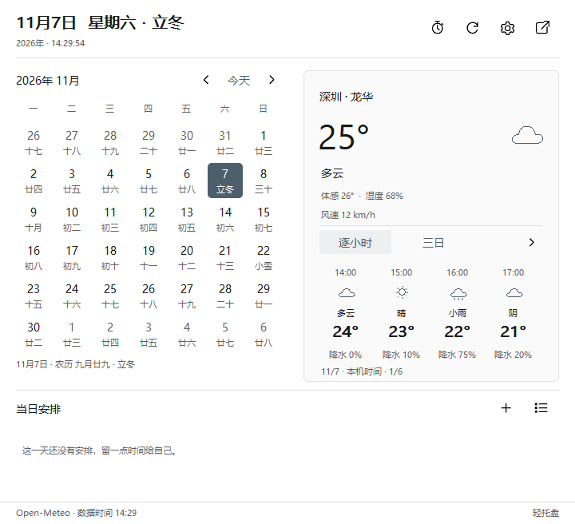

# 免 Key 小时预报

开发版 5.9 在日历右侧的天气卡片增加 **逐小时／三日** 切换。默认显示逐小时，未来 24 小时（包含当前小时）每组四小时，通过左右箭头查看。每小时包含时间、天气图标与描述、温度和降水概率；底部标明日期、本机时间和组数。切换与翻页使用已下载的数据，不重新联网，不重建日历控件，不增加滚动条。

## 来源与时间

- **Open-Meteo**：当前天气、三日及小时预报在同一个请求返回，小时字段为温度、天气代码和降水概率。公开接口无需 Key。
- **MET Norway**：现有备用来源同时解析逐小时温度和天气。仅采用 `next_1_hours`，不将六小时数据插值成逐小时，也不把降水量当成降水概率。没有概率时显示“—”。公开接口无需 Key。
- 其他来源目前未接入小时数据时，卡片明确显示暂无小时预报。可以在“天气来源”把 Open-Meteo 放在首位。

Open-Meteo 请求使用 Unix 时间戳，内部保存 UTC，界面按本机时区显示并明确标注；跨午夜的页面显示两个日期。每天预报仍按来源位置的当地日期显示。旧的 ISO 格式解析保持兼容。小时数据随原有天气刷新周期更新，无额外定时器或 API 请求。

来源文档：[Open-Meteo](https://open-meteo.com/en/docs)、[MET Norway Locationforecast](https://api.met.no/weatherapi/locationforecast/2.0/documentation)。服务受各提供方公开接口的条款与可用性约束。

## 数据与缓存

小时字段兼容旧缓存，旧版没有小时数据时仍可加载当前天气。解析时检查温度、时间范围和概率，去重排序并最多保存 72 个小时；界面按当前时间筛选最多 24 小时。空值和无效行不会使已取得的当前天气失效，缺失概率不会变成零。缓存仍遵循原有城市／坐标匹配和过期规则；离线状态明确标为缓存，过期小时不显示。

## 验证

160 项自动测试与 Clippy `-D warnings` 通过；另行执行真实联网检查，Open-Meteo 与 MET Norway 都返回连续 24 个小时，Open-Meteo 同时返回三日数据及降水概率，未提供 Key、未写入正式用户配置。

原生窗口验证覆盖六组翻页边界、逐小时／三日切换、日期按钮复用、内嵌日程编辑区覆盖时隐藏天气按钮、数据过期和空状态。已检查明暗截图与 100%／150%／200% 布局。所有原生检查位于非输入测试桌面，未操作用户鼠标、键盘或前台。

本地证据：`local/ui59-tests.txt`、`local/ui59-live-hourly.txt`、`local/ui59-hourly-renders/`。

## 部署记录 · 2026-11-07

14:32:03 已后台切换到 5.9，宿主 PID 21856 → 15364。运行目录仍为 `dist/LiteTray-ui54-inline`，完整包 `dist/LiteTray-ui59-hourly`。EXE SHA256 为 `07C327F9C423B30C3C001776C856330B6231A502230D085B35728B50BA0A3D35`。用户配置与两份适配 DLL 哈希均未变化，Explorer 10960 未重启，主副屏任务栏检查无错误，输入代理 `active=true`。

真实发布 EXE 的三种设置入口在新进程中首次打开均成功（约 16–18ms），十页无外层滚动条。正式实例的设置与两个日历保持隐藏、设置打开计数为零。启动后已自动取得 Open-Meteo 最新数据：58 个剩余小时和三日预报，包含小时降水概率；界面从这些数据中显示当前起 24 小时。

证据：`local/ui59-package-check.txt`、`local/hidden-startup-packages/5.9-hourly.json`、`local/ui59-deployment.json`、`local/ui59-live-weather.json`、`local/ui59-live-taskbar.json`、`local/ui59-live-windows.json`。旧 EXE 备份为 `local/LiteTray-ui581-before-ui59.exe`。
