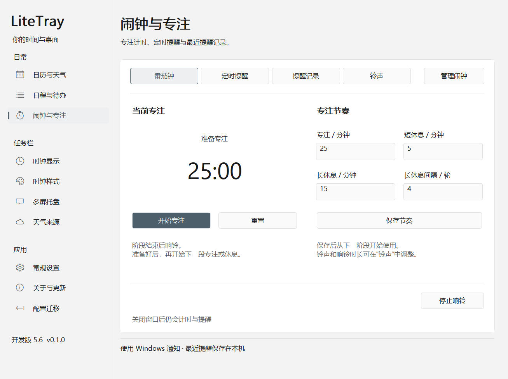

# 开发版 5.6：布局、圆角和时钟格式

本轮针对日期选中块锯齿、闹钟与专注布局、详细日期格式，以及其余页签的分组与排版。验证使用内存 DC、隐藏窗口和独立非输入桌面，不移动鼠标或切换用户桌面。

## 页面调整

| 页面 | 调整 |
| --- | --- |
| 日历与天气 | 当前／选中日期、假日徽标及共用圆角加入边缘覆盖采样；保留同屏天气和弹层编辑 |
| 时钟显示 | 两行内容模板、独立日期／时间格式、实时样例、错误提示、自动宽度与点击行为；加入紧凑年月日预设 |
| 时钟样式 | 公共字体／字号／对齐集中在顶部；两行独立样式并列，悬停提示与预览操作单独分组 |
| 多屏托盘 | 显示范围和图标复制在上方，显示器列表与刷新在下方 |
| 天气来源 | 位置、来源优先级与可选凭据分组；列表旁放置排序操作和请求参数 |
| 常规设置 | 外观、后台运行、数据维护三组统一行距与分隔 |
| 关于与更新 | 版本信息、更新状态和操作、更新偏好与仓库分组 |
| 配置迁移 | 选择文件入口、转换报告、采用与导出顺序排列 |
| 日程与待办 | 左侧列表／新建，右侧明确新建或编辑状态；六类 Tab 保留草稿，统一日期、重复、提醒和备注布局 |
| 闹钟与专注 | 左侧专注计时和操作，右侧 2×2 节奏参数；定时器操作回到所属列表下方；铃声短表单、提醒记录空状态 |



## 日期与时间格式

在“时钟显示”填写日期格式或时间格式，分别作用于模板变量 `%date%`、`%time%`。下表以 2026-11-07 15:05:09 为例。

| 字段 | 格式 | 结果 |
| --- | --- | --- |
| 日期格式 | `yyyymmdd` | `20261107` |
| 日期格式 | `yyyy-MM-dd` | `2026-11-07` |
| 日期格式 | `yy/M/d ddd` | `26/11/7 周六` |
| 日期格式 | `yyyy年M月d日 dddd` | `2026年11月7日 星期六` |
| 时间格式 | `HH:mm:ss` | `15:05:09` |
| 时间格式 | `h:m:s tt` | `3:5:9 下午` |

`yyyy/yy` 是年，`M/MM` 是月，`d/dd` 是日，`ddd/dddd` 是中文星期。日期段允许小写 `m/mm` 表示月份；遇到小时 `H/h` 后，小写 `m/mm` 表示分钟。时间字段的小写 `m/mm` 始终表示分钟，`H/HH` 为 24 小时，`h/hh` 为 12 小时，`s/ss` 为秒，`t/tt` 为上午／下午。中文和标点可直接填写，普通英文使用单引号，单引号内的两个单引号表示一个字面单引号，也支持反斜杠转义。

旧配置的日期默认 `yyyy/MM/dd`，原“显示秒”设置会转换为可见时间格式供编辑；仅访问页面不会改变配置或触发未保存提示。原有 18 个 `%…%` 变量保留。天气文本只插入一次，不重新解释为模板。显式秒字段继续驱动后台每秒更新。

## 复现与验证

日期按钮测试通过实际 `WM_PRINT` 绘制已选中的日期。旧 `RoundRect` 在角部测得 **0 个过渡像素**，断言失败；修复后浅色／深色真实日期按钮均通过。实现仅缓存最多 32 个小型预乘透明度角部蒙版，直线区域仍由 GDI 填充，无额外图形依赖。

逐页图像复核发现，旧的几何检查忽略了 1 像素分隔线与按钮相交，也没有检查空备注框的滚动条。本轮先让检查对这两种情况失败，再修改布局，检查重新通过。今后细线相交也属于重叠，空白多行输入框出现纵向滚动条会直接失败。

验证命令：

```powershell
.\tools\Invoke-Cargo.ps1 -CargoArguments @('test','--workspace','--all-targets','--locked','--','--test-threads=1','--nocapture')
.\tools\Invoke-Cargo.ps1 -CargoArguments @('clippy','--workspace','--all-targets','--locked','--','-D','warnings')
.\tools\Render-UI.ps1 -OutputDirectory local\ui56-final-renders
.\tools\Render-Panel.ps1 -OutputDirectory local\ui56-final-renders
```

原生检查覆盖最小 1060×820 及 1120×920 逻辑尺寸、100%／125% 缩放、浅深色、10 个主页面、6 类日程和 4 个计时子页；弹层图另外覆盖 100%／150%／200%。包括文本边界、控件相交、空输入框与长备注、字体下拉框、最大字号预览、键盘焦点、预设／主题／缩放后的缓存失效，以及隐藏进程首次打开设置。图中的天气和事项为隔离示例数据。

这些检查覆盖已列出的窗口尺寸和状态，不替代未知 DPI、系统版本以及长期真实桌面使用的兼容验收。

## 本次结果与部署

- 工作区自动测试 **140 通过，4 项按设计忽略**；3 项离屏渲染测试另行运行通过。Clippy `-D warnings` 通过。
- 最后一次测试进程测量：样式页首次切换 82.5 ms，反复切换中位数 10.0 ms、最大 11.9 ms。
- 实际发布 EXE 在三个全新隐藏进程中测试日历／托盘菜单／直接命令入口：均一次请求一次完成，窗口可见且未最小化；每个进程的十个主页面均无外层滚动条。发布包反复切换时钟两页 12.18–20.62 ms，首次样式页 72.72–118.74 ms。
- 2026-11-07 04:47:39 已将运行目录 `dist/LiteTray-ui54-inline` 切换为 **开发版 5.6**，宿主 PID 42080；目录名保留既有启动路径。完整包位于 `dist/LiteTray-ui56-layout`。
- EXE SHA256：`CE7F900DE7AD25AFA6C45A8A00A42215B5F4CDD510E9AB595BE42E5DBBC0A5C2`。
- 仅切换宿主。任务栏 Explorer PID 34284、主 QQNT PID 20412 的启动时间保持原值。新版设置和两个预热日历均隐藏，未发送打开指令或键鼠输入。
- 只读任务栏检查：主副屏显示原有已保存时钟内容，顶层／两屏捕获及几何错误均为空，托盘输入代理 `active=true`。后台工作集一次采样约 25.9 MiB。

本地证据：`local/ui56-tests.txt`、`local/ui56-final-renders/`、`local/hidden-startup-packages/5.6-layout*.json`、`local/ui56-deployment.json`、`local/ui56-live-windows.json`、`local/ui56-live-taskbar.json`。旧宿主备份为 `local/LiteTray-ui55-before-ui56.exe`。

## 5.6.1 导航焦点修正

左侧导航不再调用 `DrawFocusRect` 绘制异或虚线框。鼠标点击保留选中背景和左侧标记；键盘焦点使用背景和文字强调，普通按钮仅在系统允许显示焦点提示时绘制焦点框。原生键盘导航检查与 Clippy 通过。

2026-11-07 04:54:29 已后台切换为 5.6.1，宿主 PID 39036，Explorer PID 34284 未变化。实际发布包的独立隐藏进程首次打开验证通过；主副屏捕获及几何错误为空，托盘输入代理保持启用。证据：`local/ui561-deployment.json`、`local/ui561-live-taskbar.json`。
