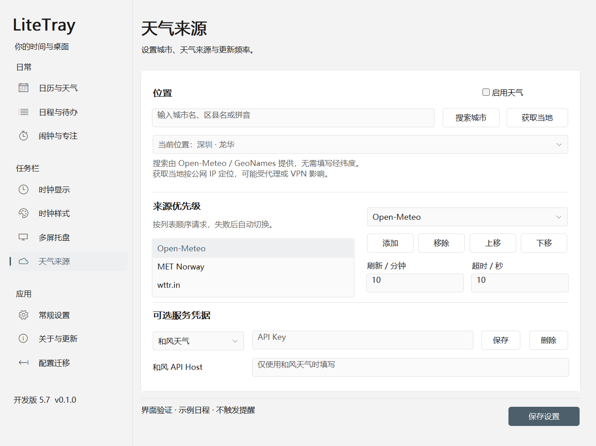

# 天气位置：获取当地与城市搜索

开发版 5.7 在“天气来源 → 位置”提供两种选择方式。用户无需查找或手动填写经纬度。

- **获取当地**：按当前网络的公网 IP 获取近似城市，自动填写到设置草稿；界面标明定位来源。代理或 VPN 可能让结果指向网络出口城市，定位不准时可改用城市搜索。
- **搜索城市**：输入城市名、区县名或拼音，点击“搜索城市”或按回车。展开结果列表，根据省、市、国家选择正确位置，坐标一并填写。同名结果不会自动取第一项。
- **保存设置**：选择或定位仅更新草稿，保存后才用于天气请求。不发起搜索时保留已有城市与坐标；查询失败不会清空位置。



## 免费接口与来源

城市搜索调用 [Open-Meteo Geocoding API](https://open-meteo.com/en/docs/geocoding-api)，位置数据来自 [GeoNames](https://www.geonames.org/)。[接口服务源码](https://github.com/open-meteo/geocoding-api)以 AGPL-3.0 开源。当前调用公开无需密钥端点，正式使用需遵守服务方的使用条款。小区或街道不一定收录；没有结果时可搜索所属城市或拼音。

自动定位先调用 [IPWHOIS](https://ipwhois.io/documentation) 的中文接口，失败后调用 [GeoJS](https://www.geojs.io/docs/v1/endpoints/geo/)；[GeoJS 源码](https://github.com/jloh/geojs)采用 MIT 许可证。IPWHOIS 是公开托管服务，不将它称为开源。两者当前均提供无需密钥的公开接口。

仅在点击查询按钮时访问以上服务，不在启动、定时刷新天气或打开设置页时自动定位。不修改系统代理或申请 Windows 精确位置权限。选择后只保存城市名与坐标，不保存服务返回的 IP 地址。

## 实现与验证

网络请求使用后台线程和已有 HTTPS 客户端。单次服务超时为 8 秒，IP 定位最多尝试两个来源。界面显示忙碌状态并阻止重复提交，查询过程中可继续切换页签。结果按请求序号、搜索词和当时的位置核对；过期回复不会覆盖新输入或后来选择的位置。

单元与原生窗口验证覆盖：中文及特殊字符查询编码、同名城市分辨、非法坐标／空数据拒绝、IP 来源回退、不保存 IP 字段、仅更新草稿、保留其他表单输入、离开页面后的回复处理和旧请求丢弃。真实联网验证检查了中文“深圳”搜索、公开 IP 服务及后台线程查询后原生下拉列表填充。

验证命令：

```powershell
.\tools\Invoke-Cargo.ps1 -CargoArguments @('test','--workspace','--all-targets','--locked','--','--test-threads=1','--nocapture')
.\tools\Invoke-Cargo.ps1 -CargoArguments @('test','--lib','live_public_location_services','--','--ignored','--nocapture')
.\tools\Invoke-Cargo.ps1 -CargoArguments @('test','--bin','LiteTray','live_city_search_populates_native_choices_without_blocking_navigation','--','--ignored','--nocapture')
.\tools\Render-UI.ps1 -OutputDirectory local\ui57-location-renders
```

联网测试和界面测试均使用隔离数据或非输入桌面，不改变用户的实际天气城市，不移动鼠标或切换用户桌面。

## 2026-11-07 发布验证

完整测试 146 项通过，6 项显式忽略；其中城市/IP 联网测试、真实异步城市查询和原生界面渲染另行执行通过。Clippy `-D warnings` 通过。重新检查浅色、深色截图，天气页的来源列表显示三行且无多余滚动条。实际发布 EXE 在三个独立非输入桌面冷启动，日历、托盘、直接打开三种入口首次均成功，内部显示耗时约 19–33ms；十个设置页均无外层滚动条。

05:05:31 已后台部署 5.7，完整包为 `dist/LiteTray-ui57-location`，实际运行目录仍为 `dist/LiteTray-ui54-inline`，宿主 PID 39036 → 9140。EXE SHA256 为 `5A74B034FCCAA1AB9B7EE6C2A3B7EDF481486185DDD8B15E2A466C940BBCFEF3`。两份适配 DLL 未变，Explorer 34284 与 QQ 20412 启动时间未变。正式窗口标题已确认，设置保持隐藏；主副屏任务栏 `error`、`geometry_error` 均为空，托盘输入 `active=true`。

本地证据：`local/ui57-tests.txt`、`local/ui57-location-renders/`、`local/hidden-startup-packages/5.7-location.json`、`local/ui57-deployment.json`、`local/ui57-live-summary.json`、`local/ui57-live-taskbar.json`。旧宿主保存在 `local/LiteTray-ui561-before-ui57.exe`。
